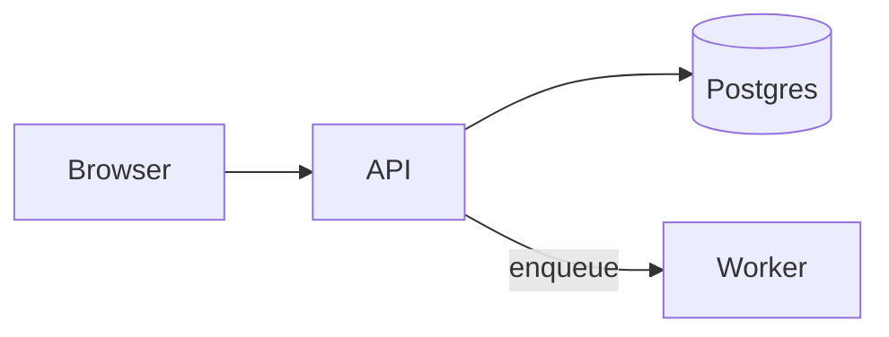

## Activation Contract

Load this skill when writing documentation that explains structure, flow, or timing, or when asked for a diagram. GitHub, GitLab, the amauta portal and most markdown viewers render a fenced block tagged `mermaid`; no image file is needed.

## Hard Rules

- Draw only when a picture beats prose: 4+ components with relations, a multi-actor exchange, a lifecycle, a schema. Otherwise write a sentence or a list.
- One idea per diagram, at most about 12 nodes. Split a bigger one; do not shrink the font.
- Keep the diagram in the markdown it explains: a ```` ```mermaid ```` fence next to the paragraph, never a pasted image of it.
- Label with the real names of the code (service, table, function), not generic boxes. Add a one-line caption sentence before the fence saying what to look at.
- Quote any label with spaces or punctuation: `A["Parse (v2) input"]`. Entity codes work inside quotes: `#quot;` for a double quote, `#35;` for `#`.
- Never put untrusted text (user data, issue titles, file contents) in a diagram without quoting and escaping it as above.
- Validate before saying done (see Validation). Fix parse errors; do not hide them.

## Choosing the type

| Show | Use | Opening line |
|---|---|---|
| Architecture, pipeline, decision flow | flowchart | `flowchart LR` (or `TD`) |
| Who calls whom, in time order | sequence | `sequenceDiagram` |
| Tables and relations | ER | `erDiagram` |
| Lifecycle of one object | state | `stateDiagram-v2` |
| Types and inheritance | class | `classDiagram` |
| Schedule, milestones | gantt | `gantt` |

## Syntax traps

- Node ids are plain words (`api`, `db1`), unique, no spaces or dashes. A lowercase `end` breaks flowcharts and sequence blocks: write `End` or `"end"`, never a bare `end` as an id or label.
- Do not start an id with `o` or `x` right after `---` (`A---oB` draws a circle edge); put a space or use a different id.
- Flowchart shapes: `A[text]`, `A(rounded)`, `A{decision}`, `A[(database)]`. Edges: `-->`, `-.->`, `==>`, with a label `A -->|"yes"| B`.
- Grouping: `subgraph name["Title"]` ... `end`; nest sparingly.
- One statement per line, indented; `%%` starts a comment line.
- Sequence: declare `participant A as "Service A"` once; use `->>` for calls, `-->>` for replies; close `alt`/`loop`/`opt` blocks with `end`.
- ER: `USER ||--o{ ORDER : places`; relation labels are one word or quoted.
- State: `[*]` is start and end; a transition is `A --> B: event`.
- Gantt needs `dateFormat YYYY-MM-DD` and a `section` before its first task.
- Emoji, `<br/>` and HTML are unreliable across renderers; avoid them.

## Example



## Validation

1. Run `amauta mermaid check <file.md>` when the `amauta` CLI is on PATH: it parses every ```` ```mermaid ```` fence with the bundled Mermaid parser and exits 1 on a syntax error, printing file:line. It checks syntax only, not layout.
2. Without the CLI, open the file in the amauta portal (Memories shows fences from file memories) or push the branch and look at GitHub's preview; a broken fence shows an error box instead of a diagram.
