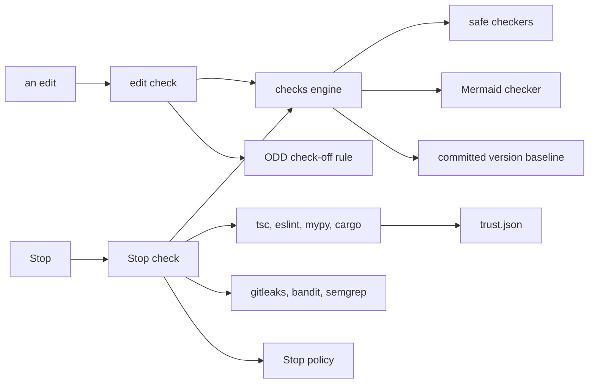
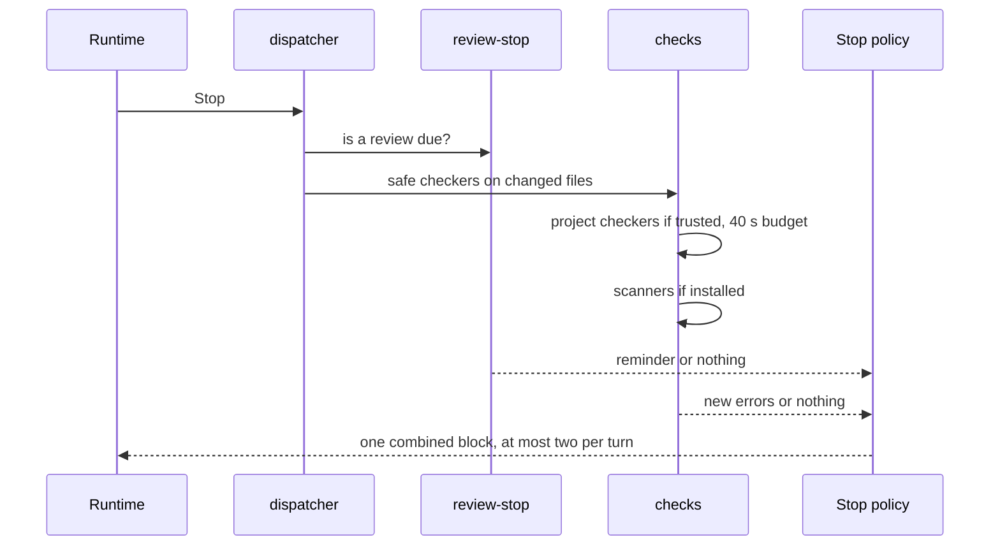

# Code security

The code security pillar gives the agent compiler-like feedback: after an edit it sees `file:line:col: error: message [checker]` lines and fixes them in the same turn, and at Stop the changed files of the repository are checked again (ADR 0006). Only errors the change added count, because each file is compared with its last committed version. Checkers that execute repository code run only in a project you trusted.

## What it is made of

| Part | Where | Role |
| --- | --- | --- |
| Checks engine | `src/checks/engine.js` (kernel) | One finding format, a time limit per checker, the committed-version baseline |
| Safe checkers | `src/checks/safe.js` | JSON in process, JavaScript with `node --check`, Python with `ast.parse`, TOML with `tomllib`, shell with `bash -n`, secret-like values through the detector catalog |
| Mermaid checker | `src/mermaid/check.js`, `src/mermaid/cli.js` (the `code-security` module) | Every Mermaid fence in Markdown, parsed by the vendored Mermaid without a browser |
| Project checkers and scanners | `src/checks/project.js` | `tsc`, `eslint`, `mypy`, `cargo check` (need trust); `gitleaks`, `bandit`, `semgrep` (read code only) |
| Trust | `src/checks/trust.js`, `src/checks/cli.js` | `amauta check trust\|untrust\|status`, stored in `<state dir>/checks/trust.json` |
| Hook side | `src/hooks/checks.js` | The edit check, the Stop check and the ODD check-off rule |

No checker is installed by amauta: they are found in `node_modules/.bin` or on `PATH`, and skipped when missing.

## How the parts relate



## How you use it

Mostly you do nothing: install turns the checks on (`amauta install --no-checks` turns them off).

- **After an edit** in Claude Code (`PostToolUse` on `Edit`, `Write`, `MultiEdit`, `NotebookEdit`), the safe checkers for the file's type run. New errors come back as one block of finding lines, so the agent fixes them in the same turn. A checker that cannot start or runs over 10 seconds is skipped.
- **At Stop** (both runtimes), the same safe checkers run over every changed file of the repository from `git status`, which includes edits made through the shell or by Codex. In a trusted project the project checkers run too, when configured and installed, and the security scanners run when installed.
- **Trust a project** once you are happy for its own tooling to run:

```bash
cd ~/code/weekly-sales
amauta check status      # which checkers apply here, and whether the project is trusted
amauta check trust       # allow tsc, eslint, mypy and cargo at Stop, and portal pipeline runs
amauta check untrust
```

- **Check diagrams** in documentation yourself:

```bash
amauta mermaid check docs/architecture.md README.md
```

## Scripts and commands

| Command | What it does |
| --- | --- |
| `amauta check trust [--cwd DIR] [--state-dir DIR]` | Trust the git root of DIR; records the sha256 of its `.amauta/pipelines.json` |
| `amauta check untrust [--cwd DIR]` | Remove it from the list |
| `amauta check status [--cwd DIR]` | The applicable checkers and the trust state |
| `amauta mermaid check FILE.md...` | Validate every Mermaid fence; exit 1 with `file:line` on a syntax error |
| `amauta install --no-checks` | Install without the edit and Stop checks |

| Checker | Needs | Runs when |
| --- | --- | --- |
| `tsc` | trust, `tsconfig.json` | TypeScript files changed |
| `eslint` | trust, an eslint config | JavaScript or TypeScript files changed |
| `mypy` | trust, `mypy.ini` | Python files changed |
| `cargo check` | trust, `Cargo.toml` | Rust files changed |
| `gitleaks` | installed | any file, output redacted |
| `bandit` | installed | Python files |
| `semgrep` | installed, the project's own `.semgrep.yml` | any file, metrics off, never `--config auto` |

## How it works

### The baseline

For each file, the engine runs the checkers on the current text and on the last committed version (`git show HEAD:<file>`, in a temp directory), then keeps only the findings the edit added, matched by checker and message so moved lines do not count as new. A new file has no baseline: every error counts. Nothing is cached project-wide.

### Trust

`tsc`, `eslint`, `mypy` and `cargo` load the project's own configuration, plugins and build scripts, so they execute repository code. They run only in a project listed in `trust.json`. The scanners only read code and need no trust. The same trust entry covers pipelines: it records the hash of `.amauta/pipelines.json`, and the portal runs a project's pipelines only while that file is the one you trusted ([[guide:pipelines|The pipelines orchestrator]]).

### The Stop check and the Stop policy



The project checkers share a 40-second budget inside the one Stop hook, whose timeout is 60 seconds like every other hook. Only errors in changed files are reported. The review reminder and the checks go through one Stop policy: one combined block, and at most two blocks while the runtime keeps going because of a Stop hook. A natural stop resets the count.

### The ODD check-off rule

When an edit of `odd/tasks/*.md` checks an item off (compared with the committed version) while the changed files of the repository have errors, the edit check answers with a block naming the task ids and the errors: fix them, or leave the task open. See [[guide:odd|ODD and review]].

### Secrets and Mermaid

The secrets checker runs `python3 -P -m amauta.detectors secrets FILE` on any text file and reports line and column, never the value; binary files and files over 1 MiB are skipped. The Mermaid checker runs `mermaid.parse()` under plain Node in a bare `node:vm` context with no DOM. It checks syntax only; layout and rendering still need a browser, such as the portal. The Stop check also validates Mermaid fences and looks for secrets in changed deliverables.

Codex edits arrive as patches through its shell, so Codex has no edit check yet; it gets the Stop check. Related: [[guide:data-security|Data security]] for the detector catalog, [[guide:kernel|The kernel]] for the dispatcher.
