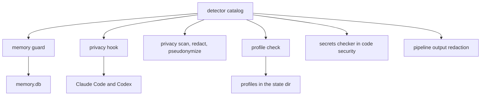
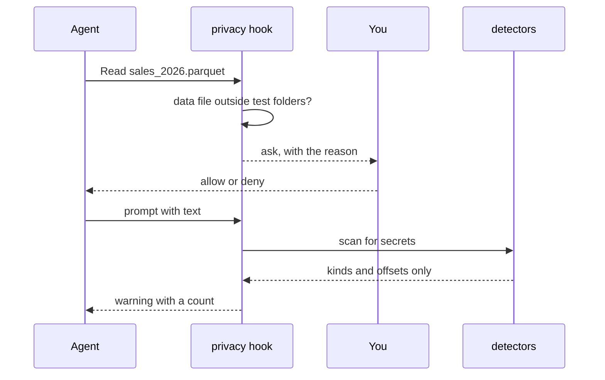
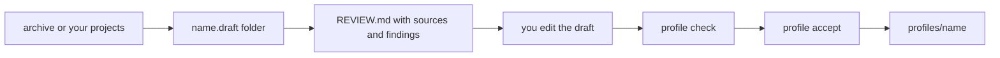

# Data security

The data security pillar keeps sensitive data and secrets from reaching the model, the memory or a repository by accident. It is friction, not isolation (ADR 0007): amauta has no sandbox and does not pretend to. It asks before a data file is read, warns when a prompt holds a secret, refuses secrets in memory, and gives you local tools to scan, redact and pseudonymize data. Organization knowledge lives in private profiles on your machine, never in a repository.

## What it is made of

| Part | Where | Role |
| --- | --- | --- |
| Detector catalog | `python/amauta/detectors/` (kernel) | Secret patterns and identifier validators: cedula and RUC with check digits, cards by Luhn, IBAN, e-mail, phones. One text scan whose findings carry a kind and offsets, never the value |
| Memory guard | `python/amauta/memory/guard.py` (kernel) | Always on: refuses secret-like text, replaces identifiers with `[REDACTED_<KIND>]` |
| Privacy hook | `python/amauta/privacy/hook.py` | Asks before a data file is read; warns about a secret in a prompt; never denies |
| Privacy CLI | `python/amauta/privacy/__main__.py`, `columns.py`, `pseudonymize.py` | `amauta privacy scan\|redact\|pseudonymize` |
| Data file rules | `python/amauta/privacy/paths.py` | Which files count as data files, plus your own paths |
| Profiles | `python/amauta/privacy/profiles.py`, `profile_import.py`, `assets/profiles/default/` | The neutral default profile and private organization profiles |

The same catalog also serves code security (secrets in edited files) and the pipelines (redaction of output lines).

## How the parts relate



## How you use it

### The privacy hook

In Claude Code, the hook runs on `PreToolUse` for `Read`, `NotebookRead` and `NotebookEdit`. When the file looks like a data file it answers **ask**: the runtime shows you the reason and you decide. Data files are CSV, TSV, Excel, Parquet, SPSS, Stata, SAS, R data, JSON Lines, SQLite and Access files outside `test`, `fixture`, `example` and `sample` folders, plus anything under the paths you list in `<state dir>/privacy.json`:

```json
{ "paths": ["/data/exports"] }
```

On `UserPromptSubmit` (both runtimes) it scans the prompt for secrets and shows a warning with a count; the prompt was already sent, so rotate a real key. It never denies and never repeats the text it found. Codex reads files through its shell, so it gets only the prompt check. Turn the hook off with `amauta install --no-privacy`.

### The memory guard

You do not call it. Every title, content, prompt and session summary the memory writes passes through it. Secret-like text (API keys, bearer tokens, private keys, cloud keys, `password=...`) is refused with the fixed reply `rejected: secret-like content` and nothing is written. Identifiers are replaced by placeholders, and the tool reply says how many of each kind, never which. The Security page in the portal shows how many values were redacted.

### Working on a data file

```bash
amauta privacy scan orders.csv notes.txt          # kinds, lines, identifier columns; exit 1 when anything is found
amauta privacy redact notes.txt -o notes.redacted.txt
amauta privacy pseudonymize orders.csv --columns customer_id,email -o orders.pseudo.csv
```

`scan` can gate a commit because it exits 1 on a finding. `redact` writes a copy with placeholders and never changes the source. `pseudonymize` replaces each value of the named CSV columns with `<COLUMN>_<12 hex>` from a keyed hash; the same value gives the same pseudonym, so joins still work. The key is 32 random bytes in `<state dir>/privacy.key` (mode 0600), created once and never printed. A pseudonym is not anonymity: other columns may still identify a person.

### Profiles

A profile says what an organization's work looks like without putting it in a repository:

| File | Holds |
| --- | --- |
| `brand.md` | Palette, fonts, logo and template file names |
| `conventions.md` | Naming, code and SQL style, date and number formats, language of deliverables |
| `glossary.md` | Approved terms and metric definitions |
| `sources.md` | Data sources by purpose and owner role; never hosts, connection strings or credentials |
| `people/roles.md` | Roles only; never names, e-mail addresses or phone numbers |

Layers, first match wins per file: the project (`<repo>/.amauta/profile/<file>`), the selected organization profile (`<state dir>/profiles/<name>/`), then the shipped neutral `default`. The selection is stored per git root in `<state dir>/profiles/selection.json`, so an organization's name never lands in a repository.

## Scripts and commands

| Command | What it does |
| --- | --- |
| `amauta privacy scan [--json] FILE...` | Report identifiers and secrets: counts, lines, columns; never values |
| `amauta privacy redact FILE -o OUT` | A redacted copy of a text file |
| `amauta privacy pseudonymize FILE --columns A,B -o OUT [--state-dir DIR]` | A CSV copy with keyed pseudonyms |
| `amauta profile list` | The profiles on this machine |
| `amauta profile new <name>` | A private profile from the default files |
| `amauta profile use <name> [--cwd D]` | Select it for the project that contains D; `use default` clears it |
| `amauta profile show [--cwd D]` | Which file comes from which layer |
| `amauta profile check <name>` | The privacy guard over a profile: secrets, identifiers, contacts, names in `people/`; exit 1 on a finding |
| `amauta profile import <name> <archive>` | A draft from an agent archive |
| `amauta profile harvest <name> --from DIR` | A draft from your projects: Power BI themes, model measures, contribution and style guides |
| `amauta profile accept <name>` | Install the reviewed draft; refused while the guard finds anything |

## How it works



Every part asks the same catalog and gets back kinds and offsets, so no tool ever has to print a value to report it. The hook fails open: on any error it prints nothing and the read goes on as usual.

Profiles go through a draft first:



`import` and `harvest` write `<state dir>/profiles/<name>.draft/` and a `REVIEW.md` that lists every source with its destination, the skipped files (code and data; data files are never opened) and the guard findings by file, line and kind. `accept` keeps an existing profile as `<name>.bak-<time>`. A profile is never synced, linked into a skills folder or published. Fixtures in tests are generated, never real.

Related: [[guide:code-security|Code security]] for secrets in edited code, [[guide:kernel|The kernel]] for the memory store, [[guide:pipelines|The pipelines orchestrator]] for output redaction.
