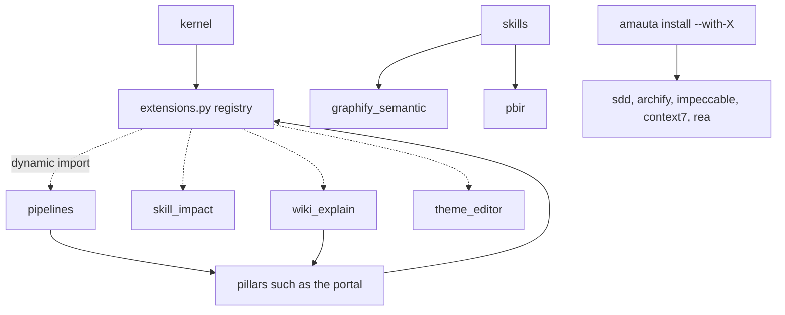
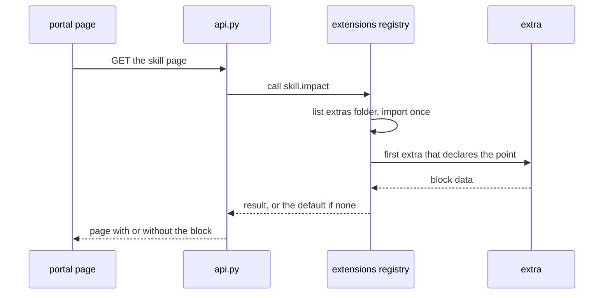

# Optional modules and extras

Beyond the kernel and the four pillars, amauta has two kinds of additions. **Optional modules** are installed only when you ask (`amauta install --with-<module>`) and removed by `--without-<module>` or `uninstall`. **Extras** are code under `python/amauta/extras/` that the kernel and pillars never import: they reach it through the extension registry, so deleting an extra's folder removes its feature and nothing else (ADR 0009).

## What it is made of

### Optional modules

| Module | Flag | What you get |
| --- | --- | --- |
| `sdd` | `--with-sdd` | Spec-driven development: `sdd-*` skills and agents, commands renamed to `/amauta-sdd-*`, a read-only status module, and the SDD preflight hook |
| `archify` | `--with-archify` | The vendored archify diagram skill: the agent writes typed JSON, `bin/archify.mjs` renders a self-contained HTML diagram; the portal's Harness page uses it too |
| `impeccable` | `--with-impeccable` | The vendored impeccable design skill (`craft`, `shape`, `critique`, `audit`, `polish`, `live` and more) and its pinned engine, installed with `npm` once |
| `context7` | `--with-context7` | A third-party MCP server entry run through `npx` |
| `rea` | `--with-rea` | A third-party MCP server entry run through `npx` (it lists about 300 tools) |

All five are off by default and sticky until you turn them off. `context7` and `rea` run unsandboxed and use the network, which is why they are opt-in.

### Extras

| Extra | Folder | Extension points | What it does |
| --- | --- | --- | --- |
| Pipelines | `extras/pipelines/` | `GET /api/pipelines`, `GET /api/pipelines/events`, `GET /api/pipelines/check`, `pipelines.run`, `pipelines.cancel` | Runs a project's processes; the Pipelines tab ([[guide:pipelines|The pipelines orchestrator]]) |
| Skill impact | `extras/skill_impact/` | `home.impact`, `skill.impact` | Compares sessions that loaded a skill with sessions that did not; comparative, not causal |
| Wiki explanations | `extras/wiki_explain/` | `harness.explain`, `harness.pending`, `lint.categories`, `portal.explain_request` | Queued requests for a written explanation of a harness component, and the notes Claude writes back |
| Theme editor | `extras/theme_editor/` | `themes.list`, `themes.write`, `themes.delete` | Custom light and dark themes in `<state dir>/themes/*.json` |
| Graphify semantic | `extras/graphify_semantic/` | none | The no-API-key semantic pass of the `graphify-semantic` skill, plus Markdown sidecars for PowerPoint decks |
| PBIR tools | `extras/pbir/` | none | Lint, diff, data dictionary, layout audit, broken field references, a structural rename and a report theme file for Power BI projects, used by the `powerbi-report` skill |

## How the parts relate



Layers, from `MODULES.json`: optional modules import only the kernel; an extra may import the kernel and pillars; nothing imports an extra statically, and `test/architecture.test.js` fails if something does. Extras with no extension points (graphify semantic, PBIR tools) are reached as command-line modules from their skills.

## How you use it

### Add or remove an optional module

```bash
amauta install --with-sdd --with-archify     # add
amauta install --without-archify             # remove one again
amauta status                                # shows what is installed, and checks the archify CLI and impeccable engine
```

You can also switch modules in the portal's Settings page, which runs the same install with a preview ([[guide:portal|The portal]]). Undoing a change that turned `impeccable` off does not bring its engine back; run reinstall or repair.

### SDD

SDD is used only when you ask for it or accept a proposal; size or risk alone never selects it. The `/amauta-sdd-*` commands work over `openspec/changes/<change>/`. Before an `sdd-*` subagent is dispatched, the parent must ask the three-question preflight and you must answer it; the hook then adds the preflight block to the prompt. It is the one hook that fails closed, for `sdd-*` dispatches only.

### Use the extras

- **Pipelines**: `amauta pipeline ...` and the Projects > Pipelines tab.
- **Skill impact**: the Home rail and each skill page; a side with fewer than 5 sessions shows "not enough data".
- **Wiki explanations**: press Request explanation on a component page, then ask Claude Code to process the wiki explanation requests (skill `amauta-wiki-explain`).
- **Theme editor**: Settings > Themes, with live preview, contrast warnings, import and export.
- **Graphify semantic**: ask for a semantic pass; the skill plans chunks and dispatches one read-only extractor subagent per chunk.
- **PBIR tools**: the `powerbi-report` skill calls them on a PBIP project.

### Add an extra of your own

1. Create `python/amauta/extras/<name>/__init__.py` with a header comment and `POINTS = {"point.name": function}`.
2. Use only extension points the kernel or a pillar already calls (listed in `docs/modules.md`), or none for a command-line extra.
3. Import the kernel and pillars as you need; never make a kernel or pillar module import your extra.
4. Keep within the simplicity limits (file 400 lines, function 60, line 140) and add tests.

To remove an extra, delete its folder: its tab, block or command disappears and everything else keeps working.

## Scripts and commands

| Command | What it does |
| --- | --- |
| `amauta install --with-sdd\|rea\|context7\|impeccable\|archify` | Add an optional module |
| `amauta install --without-<module>` | Remove it |
| `amauta sdd status [change] [--cwd DIR] [--json] [--instructions]` | SDD status over `openspec/changes/` (read-only) |
| `amauta sdd continue [change]` | The next SDD step (read-only) |
| `amauta pipeline list\|check\|run\|status\|cancel\|schedule-hint` | The pipelines extra |
| `amauta py amauta.extras.pbir lint MODEL` | DAX and model rules as warnings |
| `amauta py amauta.extras.pbir diff OLD NEW` | Tables, columns and measures added, removed or changed |
| `amauta py amauta.extras.pbir dictionary MODEL` | A Markdown data dictionary |
| `amauta py amauta.extras.pbir layout REPORT` | Visuals outside the page, overlapping or too small; exit 1 when any |
| `amauta py amauta.extras.pbir refs REPORT MODEL` | Fields, filters and sorts in the report that the model lacks; exit 1 when any |
| `amauta py amauta.extras.pbir rename REPORT --table T --from OLD --to NEW [--apply]` | Structural rename; a dry run unless `--apply` |
| `amauta py amauta.extras.pbir theme --name N (--colors C,... \| --brand FILE \| --profile) --out FILE.json` | A report theme file from a palette, to import in Desktop; never over an existing file without `--force` |
| `python3 -P -m amauta.extras.graphify_semantic plan\|save-chunk\|validate\|merge` | The steps of the semantic pass |
| `python3 -P -m amauta.extras.wiki_explain list` and `write --kind K --id I --file note.md` | Process explanation requests |

## How it works



The registry (`python/amauta/extensions.py`) lists `python/amauta/extras/`, imports every package that has an `__init__.py` once, and reads its `POINTS`. `call(point, ...)` returns the first extra's answer or a default; `collect(point, ...)` returns all answers. An extra that fails to import contributes no points, so a broken extra cannot break the portal.

Optional modules work through the installer instead: each `--with-X` choice is recorded in the install state, rendered into the skill store and links like other skills, and removed by `--without-X` or `uninstall`. Vendored modules (archify, impeccable) keep their upstream license and checksums in `NOTICE` and `assets/manifest.json`; archify's update check is permanently off, and impeccable is pinned to the last pure-JavaScript line (3.x).

Back to [[guide:overview|amauta at a glance]].
