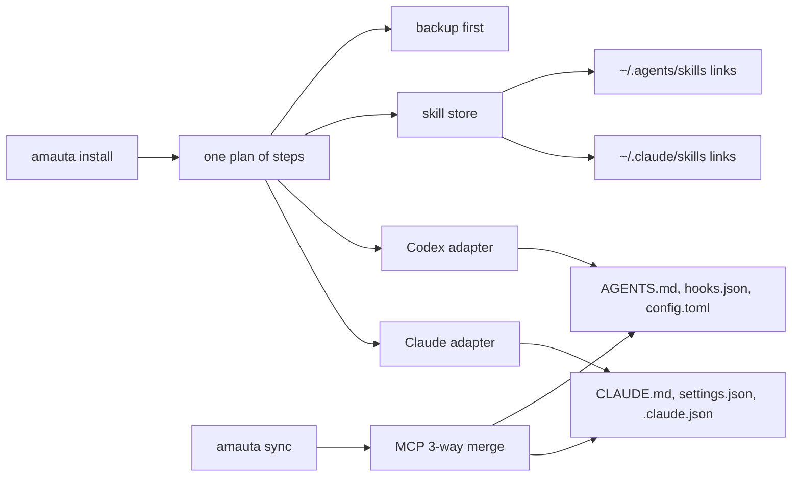
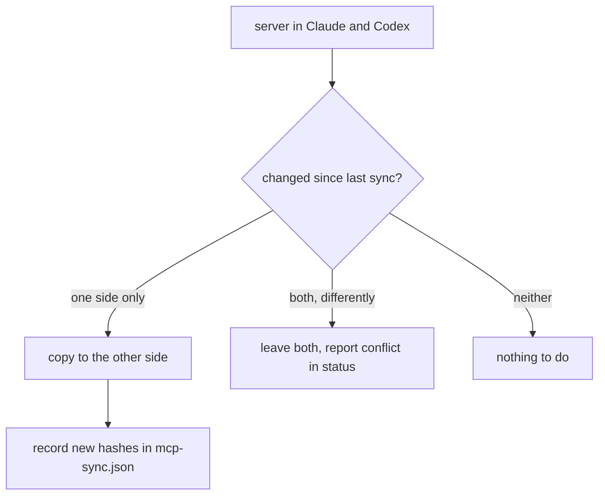

# Install and runtimes

`amauta install` sets up the harness for Claude Code, for Codex, or for both. Claude Code and Codex share one harness and neither is the master: one memory, one skill store, MCP servers synced both ways, and the same instruction blocks and hook commands written to each.

## What it is made of

| Piece | Where it goes | Notes |
| --- | --- | --- |
| Always-on instruction blocks | `~/.claude/CLAUDE.md` and `~/.codex/AGENTS.md` | Four blocks between `<!-- amauta:ID -->` markers: `codegraph-guidance`, `persona`, `engram-protocol`, `orchestrator`. Your own text is kept |
| Hooks | `~/.claude/settings.json` and `~/.codex/hooks.json` | One dispatcher command per event, each with a timeout |
| MCP servers | `~/.claude.json` and `~/.codex/config.toml` | `engram` (the memory, or `amauta-memory`), `amauta`, `codegraph` when found on `PATH`, `context7` and `rea` only on request |
| Skills | `<state dir>/skills/<name>`, linked from `~/.claude/skills/` and `~/.agents/skills/` | Rendered once into the store |
| Agents, output style | `~/.claude/` | Claude-only: review lenses, `chasqui`, `taripaq`, `haravec`, the judgment-day agents, the output style of the chosen persona |
| Permissions | `~/.claude/settings.json` | `ask` for force pushes, hard resets and `rm -rf`; `deny` for reading and editing `.env`, keys and credential files. No `defaultMode`, no allow entries |
| State | `<state dir>/state.json`, `codex-state.json`, `mcp-sync.json` | What was installed, hashes of managed files, the last synced MCP set |
| Backups | `<state dir>/backups/<timestamp>/` | Taken before every write |

The code lives in `src/install/`: `installer.js` (Claude target and the plan), `codex.js` (Codex target), `steps.js` (plan steps shared by both, ADR 0002), `skillstore.js`, `mcpsync.js`, `parity.js`, `fingerprint.js`, `upgrade.js`. `src/core/` provides the marker injector, JSON merge, the TOML editor (it edits only `[mcp_servers.*]` tables), atomic writes and backups.

## How the parts relate



One `plan()` made of steps (instructions, hooks, MCP servers, skills, assets, agents) runs once per runtime adapter. An adapter knows its paths and formats and what it does not support: Codex gets no output styles, agents or SDD commands, and no edit check or read check, because Codex edits and reads through its shell.

## How you use it

```bash
amauta install --dry-run          # see what would be written, removed or kept
amauta install                    # default runtime: both once ~/.codex exists, else claude
amauta status                     # one section per runtime
amauta sync                       # bring Claude Code and Codex in step now
```

Switches and modules are sticky: a later plain `amauta install` keeps the choices of the last one until you change them or uninstall.

| Option | Effect |
| --- | --- |
| `--runtime claude\|codex\|both` | Which runtime to install into |
| `--persona gentleman\|neutral` | The persona block and output style |
| `--review-mode on\|off` | The review switch |
| `--no-telemetry` | No telemetry and usage hooks |
| `--no-privacy` | No privacy hook |
| `--no-checks` | No edit and Stop checks |
| `--no-mirror-mcp` | Skip the MCP sync for this run |
| `--with-sdd`, `--with-archify`, `--with-impeccable`, `--with-context7`, `--with-rea` | Add an optional module ([[guide:extras|Optional modules and extras]]) |
| `--without-<module>` | Turn one module off again |
| `--force` | Replace managed files you edited (otherwise they are kept and reported) |
| `--json` | Machine-readable output |

Every target can be redirected, which is what tests and trial installs use: `--claude-home` / `AMAUTA_CLAUDE_HOME`, `--claude-json` / `AMAUTA_CLAUDE_JSON`, `--state-dir` / `AMAUTA_STATE_DIR`, `--codex-home` / `AMAUTA_CODEX_HOME`, `--codex-skills-dir` / `AMAUTA_CODEX_SKILLS_DIR`. With only `--claude-home`, the others default to paths inside it, so a sandboxed install never touches the real home.

The portal's Settings page changes a closed list of these options by running `amauta install` for you, with a preview first ([[guide:portal|The portal]]).

## Scripts and commands

| Command | What it does |
| --- | --- |
| `amauta install [options]` | Install or update |
| `amauta uninstall [--runtime ...]` | Remove everything amauta installed, keeping your own content |
| `amauta status [--runtime ...] [--deep] [--json]` | What is installed and missing; drift, MCP conflicts, parity; `--deep` also probes graphify's SQL extractor |
| `amauta sync [--dry-run] [--json] [--no-mirror-mcp]` | MCP servers both ways, skill links, Codex copies |
| `amauta restore --backup ID` | Restore an installer backup by id (`YYYYMMDDTHHMMSSZ`), Claude or Codex files |
| `amauta upgrade [--dry-run] [--to <tag>] [--yes]` | Update the checkout to the latest release tag and reinstall; `--to` picks another tag, for a rollback too |
| `amauta version` | Print the version |

## How it works

### Writing files safely

Before any write the plan takes a backup under `<state dir>/backups/<timestamp>/`. Instruction blocks are injected between markers, so text outside them stays yours. Hooks and MCP servers are merged into your existing JSON; your own hooks, servers and permissions stay. Files amauta installs are tracked by hash: if you edit one, re-install and uninstall keep your version unless you pass `--force`. `status` checks that the always-on blocks stay under their 20,000-character budget, because every session pays for them.

### The skill store and links

Skills are rendered once into `<state dir>/skills/<name>`. `~/.claude/skills/<name>` and `~/.agents/skills/<name>` are symlinks to it (directory junctions on Windows, with a hash-managed copy as fallback). A real skill directory you made in either skills folder gets a link in the other; nothing is copied or moved. A real directory with the same name on both sides is reported as a conflict.

### MCP sync

Every stdio server (`command`, `args`, `env`) goes both ways between `.claude.json` and `config.toml` as a three-way merge against the last synced set, which is kept as hashes in `mcp-sync.json`.



Keys that belong to one runtime (Claude's `type`, Codex's `startup_timeout_sec`) stay on their side. Non-stdio servers and runtime-internal servers are listed and not synced; you can add your own exclusions with `{"exclude": ["name"]}` in `mcp-sync.json`. The servers amauta writes itself are written to both sides directly, not through the merge.

### Staying in step

A cheap `SessionStart` step (`sync-check`) hashes the MCP servers and skills folders of both runtimes, the amauta version and the install choices, and runs the sync only when the hash moved. It prints nothing. `amauta status` reports what is still out of step: Codex drift, MCP conflicts, and a parity section listing servers, skills and blocks present in one runtime and not the other.

Codex asks you to trust new or changed hook commands; amauta never writes that trust state. See also [[guide:kernel|The kernel]] for the dispatcher these hooks call.
