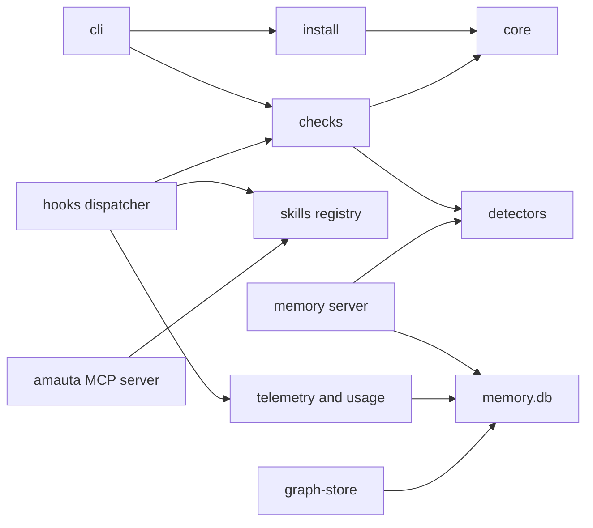
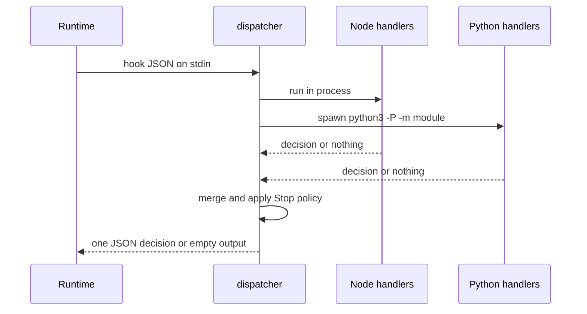

# The kernel

The kernel is the part of amauta that is always installed and that every other part builds on. It has to stay small: the pillars, optional modules and extras may import it, but the kernel imports only itself (ADR 0001). Three entry modules sit in front of it and route requests into it.

## What it is made of

The modules come from `MODULES.json`.

| Module | Layer | Paths | What it does |
| --- | --- | --- | --- |
| `cli` | entry | `bin/`, `src/cli.js` | The command router: each command is one entry in a map with a summary and a `run` function |
| `hooks` | entry | `src/hooks/` | Hook entrypoints for Claude Code and Codex: the per-event dispatcher and the edit and Stop checks |
| `mcp-server` | entry | `src/mcp/` | The `amauta` MCP server: skill registry, review assess, review mode status, ODD status |
| `core` | kernel | `src/core/`, `src/util/`, `src/version.js`, `python/amauta/__init__.py`, `paths.py`, `oscompat.py`, `extensions.py` | Marker injector, JSON and TOML merge, atomic writes, backups, git helpers, paths, the platform layer and the extension registry |
| `install` | kernel | `src/install/`, `assets/manifest.json`, `assets/core/`, `assets/generic/` | Install, uninstall, status and sync for both runtimes; the always-on instruction blocks |
| `skills` | kernel | `src/registry/`, `assets/skills/` | The skill registry and the shared stack and workflow skills |
| `memory` | kernel | `python/amauta/memory/`, `assets/engram/` | The engram-compatible SQLite memory and its MCP server |
| `telemetry` | kernel | `python/amauta/telemetry/`, `python/amauta/usage/` | Local events and transcript usage ingestion |
| `checks` | kernel | `src/checks/` | The checks engine: one finding format, the committed version as baseline, safe syntax checkers (ADR 0006) |
| `detectors` | kernel | `python/amauta/detectors/` | The detector catalog: identifier validators, secret patterns, one text scan (ADR 0007) |
| `graph-store` | kernel | `python/amauta/graph/` | The code graph mirror in `memory.db`, its queries and the refresh lock |

## How the parts relate

The layer rules, checked by `test/architecture.test.js`:

| Layer | May import |
| --- | --- |
| entry | entry, kernel, pillar, integration, optional |
| kernel | kernel |
| pillar | kernel |
| integration | kernel |
| optional | kernel |
| extra | kernel, pillar (nothing imports an extra statically) |
| tooling | anything |

A file without a module, an import that crosses layers against this table, or a recorded exception that is no longer needed fails the test. Today there is one recorded exception: `install` reads from `code-graph`, because `status` reports the codegraph and graphify versions and the last graphify hook error.

## How you use it

You rarely call the kernel by name; you meet it through other commands:

- `amauta install` and `amauta status` are the `install` module ([[guide:install|Install and runtimes]]).
- Every hook the runtimes run is the `hooks` dispatcher.
- The memory tools the agent calls (`mem_save`, `mem_search`, `mem_context` and others) are the `memory` module, registered as the MCP server `engram` (or `amauta-memory` when you already have a different `engram`).
- The checks after an edit are the `checks` engine ([[guide:code-security|Code security]]).
- The memory guard and the privacy tools share the `detectors` catalog ([[guide:data-security|Data security]]).
- The portal reads everything the kernel stores ([[guide:portal|The portal]]).

## Scripts and commands

| Command | Module |
| --- | --- |
| `node bin/amauta.js hook event <Event> --state-dir DIR --with a,b,c` | hooks: the command install writes for each event |
| `amauta skill-registry refresh [--cwd DIR] [--quiet] [--no-gitignore] [--force]` | skills |
| `amauta skill-registry list [--cwd DIR]` | skills |
| `amauta py amauta.<module> ...` | cli: runs one of amauta's Python modules with the interpreter install chose |
| `PYTHONPATH=python python3 -m amauta.memory serve` | memory: the MCP server |
| `PYTHONPATH=python python3 -m amauta.memory import-engram --from FILE` | memory: read-only, idempotent import of an engram database |
| `python3 -P -m amauta.telemetry report [--days N] [--json]` and `prune --days N` | telemetry |
| `python3 -P -m amauta.usage backfill [--runtime claude\|codex\|all]` | usage |
| `python3 -P -m amauta.graph query neighbors <node> --repo DIR` and `query path <a> <b> --repo DIR` | graph-store |

The telemetry, usage and graph commands need `PYTHONPATH=python` (and `AMAUTA_STATE_DIR` for a state directory other than `~/.amauta`) when you run them from a checkout.

The `amauta` MCP server (`src/mcp/server.js`) is a hand-rolled JSON-RPC server over stdio with four tools:

| Tool | Answers |
| --- | --- |
| `skill_registry_refresh` | Refreshes `.atl/skill-registry.md` for a project |
| `review_assess` | The review risk of the current changes |
| `review_mode_status` | Whether the review switch is on, and who decided |
| `odd_tasks_status` | Progress of the ODD task files |

## How it works

### The hook dispatcher

Install writes one command per hook event. The dispatcher (`src/hooks/dispatch.js`) reads the hook JSON once from stdin, runs the handlers named in `--with` in order, and prints at most one merged decision. Node handlers run in the same process; Python handlers (telemetry, usage, privacy) are started with `spawn`, without a shell, using the interpreter chosen at install. Any error means empty output and exit 0.

| Event | Handlers |
| --- | --- |
| `UserPromptSubmit` | `skill-registry`, `privacy`, `telemetry` |
| `SessionStart` | `review-stop`, `graphify-connect`, `sync-check`, `telemetry` |
| `PreToolUse` | `privacy` on reads (Claude Code), `sdd-preflight` on agent dispatches with `--with-sdd` |
| `PostToolUse` | `checks` on edits (Claude Code), `telemetry` |
| `Stop` | `review-stop`, `checks`, `telemetry`, `usage` |
| `SubagentStop` | `telemetry`, `usage` |

The telemetry and usage handlers appear only while telemetry is on. At Stop, the decisions of `review-stop` and `checks` go through one Stop policy: one combined block, at most two blocks while the runtime keeps going because of a Stop hook (`<state dir>/stop-policy/<session>.json`).

### memory.db

One SQLite file at `<state dir>/memory.db` holds everything local: memories with full-text search (FTS5, WAL mode, `PRAGMA user_version` migrations), telemetry `events`, usage in `usage_messages` and `tool_calls`, the code graph in `graph_nodes`, `graph_edges` and `graph_sync`. Both runtimes write to the same file; a `runtime` column tells Claude Code rows from Codex rows.

- Every title, content, prompt and summary the memory writes passes the **memory guard**: secret-like text is refused, personal identifiers are replaced by `[REDACTED_<KIND>]`.
- Telemetry stores time, session, event, tool name, project, payload size and an ok flag; never prompt text or tool input and output.
- Usage stores model, timestamps and token counts per message, plus skill, subagent and MCP server names.
- The graph mirror is refreshed from graphify's `graph.json` under a per-repo lock; the memory server also exposes it as the `graph_query` tool.

### The checks engine and the detectors

`src/checks/engine.js` defines one finding, printed as `file:line:col: severity: message [checker]`, and the baseline rule: the file's last committed version is checked in a temp directory, so only the errors an edit added are reported. `python/amauta/detectors/` validates identifiers (cedula and RUC with check digits, cards by Luhn, IBAN, e-mail, phones) and secret patterns; a finding carries a kind and offsets, never the matched text.

### The extension registry

`python/amauta/extensions.py` lists `python/amauta/extras/`, imports each package once and answers `call(point, ...)` and `collect(point, ...)` from the `POINTS` each extra declares. An extra that fails to import contributes nothing, so a broken or deleted extra never breaks the kernel. See [[guide:extras|Optional modules and extras]].

Back to [[guide:overview|amauta at a glance]].
