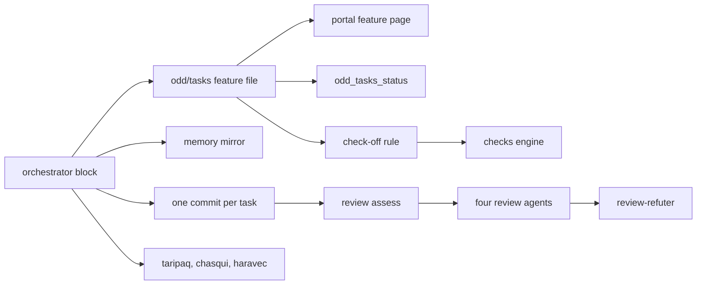
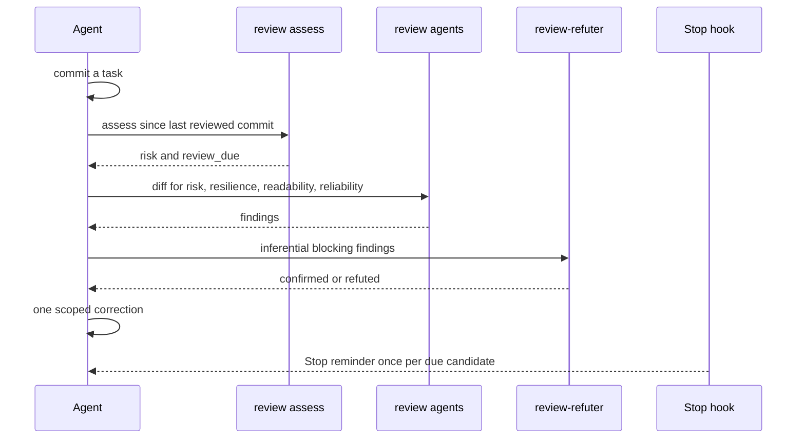

# ODD and review

ODD (Organic Driven Development) is the way of working the orchestrator block puts into every session. It is not a command you run: it is a set of always-on instructions in `CLAUDE.md` and `AGENTS.md` that the agent follows for every request, plus a few tools that make the steps checkable: task files, the memory mirror, the check-off rule, review assess and the review lenses.

## What it is made of

| Part | Where | Role |
| --- | --- | --- |
| Orchestrator block | `assets/core/orchestrator.md`, installed between `<!-- amauta:orchestrator -->` markers | The ODD steps, TDD, delegation, review and safety rules |
| Task files | `odd/tasks/<feature>.md` in your project | Objective, scope, checklist with stable ids, acceptance criteria, progress, next step |
| Memory mirror | topic `odd/<feature>/tasks` in `memory.db` | Lets an interrupted feature be resumed |
| Review code | `src/review/` (`assess.js`, `mode.js`, `stop.js`, `pack.js`, `numbers.js`) | Risk assessment, the switch, the Stop reminder, packs, number fidelity |
| Review agents | `assets/core/agents/review-*.md` | `review-risk`, `review-resilience`, `review-readability`, `review-reliability`, `review-refuter` |
| Lenses and communicator | `taripaq.md`, `haravec.md`, `chasqui.md` | Analytical lens, communication lens, the writer of deliverables (ADR 0008) |
| Portal views | `#/feature`, the project page | Progress, commits, a task diagram per feature |
| MCP tool | `odd_tasks_status` on the `amauta` server | The same count of items the portal shows |

## How the parts relate



The task file is the source of truth; the memory mirror, the portal and the MCP tool read it. `test/odd-format.test.js` pins the format and checks that the portal and the MCP tool count the same items.

## How you use it

### The ODD steps

1. **Authorize**: investigation, explanation, review and planning requests stay read-only unless you ask to implement. An ambiguous request gets one question.
2. **Explore** the code and requirements before writing.
3. **Resolve uncertainty**: one focused question only for a real product decision.
4. **Classify**: substantial means two or more meaningful steps, or progress worth recovering after an interruption. Small work stays small and gets no task file.
5. **Track before the first write**: create `odd/tasks/<feature>.md` and mirror it with `mem_save` under `odd/<feature>/tasks`.
6. **Implement task by task**: check an item off only after its outcome and checks were observed; on a feature branch, close each task with a Conventional Commit and record the hash in the task file. Push, PR and merge stay your decisions.
7. **Close**: report the verified outcome, every failed, skipped or pending check, and the next step.

To resume, the agent reads `mem_context`, then `mem_search` for the feature, then the observation, then the task file, and reconciles them.

### TDD

TDD on or off comes from the project or from you, and is recorded in the task file with its runner. When it is on, the failing test (RED) is observed before the implementation, then GREEN, then refactor.

### Delegation

The parent keeps one thin thread. Reading one to three files is done inline; needing four or more files to understand something means one read-only mapper first. One mechanical file is inline; two or more non-trivial files go to one bounded writer, which gets the files it may touch, the acceptance criteria, the TDD mode and the exact verification commands. One writer at a time; parallel writers only in isolated worktrees. The route of each task is recorded in the task file.

### A task file

```markdown
# Feature: weekly sales report
Locator: odd/tasks/weekly-sales.md (branch feat/weekly-sales)

## Objective
## Tasks
- [ ] W1 Extract last week's orders
- [x] W2 Clean the order table (a1b2c3d)
- [!] W3 Publish the report, blocked on access
## Acceptance criteria
## Progress
## Next step
```

Only top-level items count: `- [ ]` open, `- [x]` done, `- [!]` blocked. Data tasks add `## Criteria`, `## Contracts` and `## Review` (ADR 0008).

## Scripts and commands

| Command | What it does |
| --- | --- |
| `amauta review mode status\|enable\|disable [--scope global\|clone]` | The review switch; off by default; a clone-local `off` wins over global |
| `amauta review assess --base-ref <commit> --committed-only --json` | Risk (`passive`, `medium`, `high`), `review_due` and `review_due_reason` for the changes since that commit |
| `amauta review pack --feature F --kind analytical\|communication` | Writes `odd/reviews/<F>/<kind>-<n>/pack.md` for a fresh lens |
| `amauta review numbers --feature F` | Every number in a text deliverable must exist in the approved results at the precision shown; exit 1 otherwise |

Folders in your project: `odd/tasks/` (task files), `odd/contracts/<feature>/` (approved results), `odd/deliverables/<feature>/` (what `chasqui` writes), `odd/reviews/<feature>/` (packs).

## How it works

### Review mode and assess

Review is a switch you own. When it is on, after each work-unit commit the agent runs `review assess`. Passive changes (docs, images) get a structural readback only; an assessment failure counts as `high`. When review is due, the four review agents get the diff, and `review-refuter` checks blocking findings that are inferential. Findings the change caused block; pre-existing ones become follow-ups. One scoped correction per commit, no loop until clean.



The `review-stop` hook keeps a baseline at SessionStart and, while the switch is on, blocks a Stop once per candidate that `review assess` marks as due. Review outcomes never authorize a push, a PR or a release.

### The lenses

The lenses run in their case even when code review is off, unless the task file says `Lenses: off`.

- **Analysis closed**: `review pack --kind analytical`, then `taripaq` reads the pack with a fresh context; its `needs-refuter: yes` findings go to `review-refuter`. One round, plus a delta re-check after a correction.
- **A deliverable for other people**: `chasqui` writes it from the approved results only and may ask for missing measures (at most three cycles). Then `review numbers`, `review pack --kind communication` and a fresh `haravec`, which reads it as the audience would. Up to two rounds, a new `haravec` each.

Verdicts are recorded in the task file's `## Review` section.

### The check-off rule

An edit of `odd/tasks/*.md` that checks an item off, compared with the committed version, is refused while the changed files of the repository have errors the checks engine sees (the same findings as the Stop check). Fix the errors or leave the item open. See [[guide:code-security|Code security]].

Optional: with `--with-sdd`, spec-driven development is available when you ask for it ([[guide:extras|Optional modules and extras]]). Back to [[guide:overview|amauta at a glance]].
