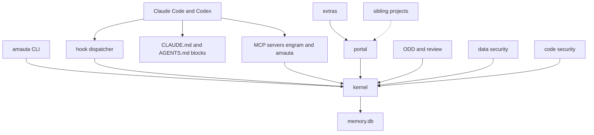
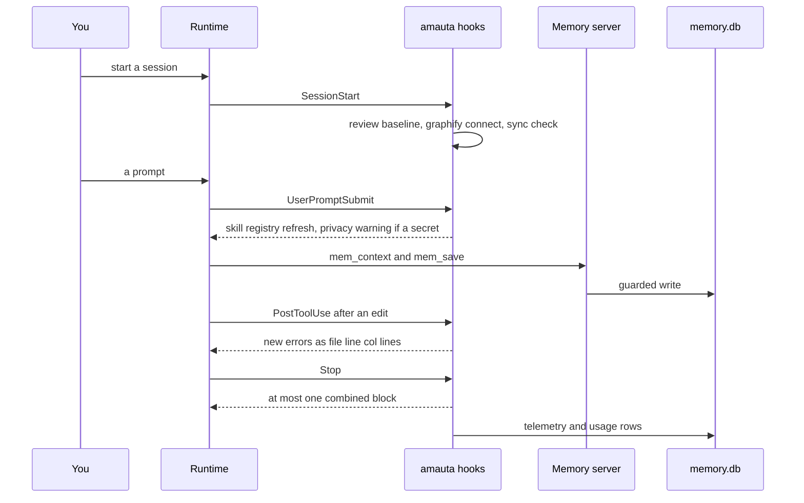

# amauta at a glance

amauta is a small harness for Claude Code and Codex, written in plain Node.js (22 or newer) and Python (3.11 or newer, standard library only). It installs instructions, hooks, skills, agents and MCP servers into both runtimes, keeps one local memory, and gives you a local portal to see what the harness knows. It has no compiled code of its own, no npm dependencies and no network code in its hooks or servers.

This page is the map. Every other page of the guide goes deeper into one part.

## What it is made of

amauta is organized in layers (ADR 0001). Every file under `bin/`, `src/`, `python/amauta/`, `assets/` and `scripts/` belongs to exactly one module in `MODULES.json`.

| Layer | Modules | Read more |
| --- | --- | --- |
| Entry | `cli`, `hooks` (the dispatcher), `mcp-server` (the `amauta` MCP server) | [[guide:kernel|The kernel]] |
| Kernel | `core`, `install`, `skills`, `memory`, `telemetry`, `checks`, `detectors`, `graph-store` | [[guide:kernel|The kernel]], [[guide:install|Install and runtimes]] |
| Pillars | `portal`, `odd`, `data-security`, `code-security` | [[guide:portal|The portal]], [[guide:odd|ODD and review]], [[guide:data-security|Data security]], [[guide:code-security|Code security]] |
| Integration | `code-graph` (glue to `codegraph` and `graphify` found on `PATH`) | [[guide:kernel|The kernel]] |
| Optional | `sdd`, `archify`, `impeccable`, plus the `context7` and `rea` MCP entries | [[guide:extras|Optional modules and extras]] |
| Extras | `python/amauta/extras/`: pipelines, skill impact, wiki explanations, theme editor, graphify semantic pass, PBIR tools | [[guide:pipelines|The pipelines orchestrator]], [[guide:extras|Optional modules and extras]] |
| Tooling | `scripts/` (migration from gentle-ai, runtime probe, developer checks) | this page |

Outside the repository there are **sibling projects**: projects that live beside amauta, which the portal links and health-checks but never runs. See [[guide:siblings|Sibling projects]].

The four pillars answer four needs:

- **Portal**: a local wiki over memories, skills, sessions, usage, ODD features and the code graph.
- **ODD**: Organic Driven Development, the always-on workflow for substantial work, with task files, TDD and review.
- **Data security**: one detector catalog, the memory guard, the privacy hook, privacy tools and organization profiles.
- **Code security**: compiler-like checks after each edit and at Stop, against the last committed version.

## How the parts relate

Claude Code and Codex reach amauta through one contract: hooks, MCP servers over stdio, skills and the always-on instruction blocks in `CLAUDE.md` and `AGENTS.md`. Behind that contract the entry layer routes to the kernel, and the pillars build only on the kernel.

The import rules are enforced by `test/architecture.test.js`:

- the kernel imports only the kernel;
- pillars import only the kernel and never each other;
- extras may import the kernel and pillars, but nothing imports an extra statically: the kernel reaches them through the extension registry (`python/amauta/extensions.py`, ADR 0009);
- calls from Node to Python (`python3 -P -m amauta.<module>`) are process boundaries and follow the same direction by convention.

## How you use it

A typical day with amauta looks like this:

1. **Install once**: `amauta install` writes the blocks, hooks, skills, agents and MCP servers into Claude Code, and into Codex when `~/.codex` exists. See [[guide:install|Install and runtimes]].
2. **Work in a session**: the orchestrator block makes ODD the default workflow. Substantial work gets a task file in `odd/tasks/<feature>.md`, mirrored into memory. See [[guide:odd|ODD and review]].
3. **Let the hooks help**: after an edit the checks report new errors; at Stop the changed files are checked again and the review reminder may fire; the privacy hook asks before a data file is read.
4. **Look at it**: `amauta portal` (or `amauta portal launch`) shows memories, sessions, usage, features, the graph, the security state, the pipelines and this guide.
5. **Run processes**: a project's `.amauta/pipelines.json` defines recurring jobs you run from the terminal or the portal. See [[guide:pipelines|The pipelines orchestrator]].

## Scripts and commands

The main commands, all from `amauta --help`:

| Command | What it does |
| --- | --- |
| `amauta install` / `uninstall` / `status` | Install into Claude Code and Codex, remove it, or report what is there |
| `amauta sync` | Sync Claude Code and Codex now: MCP servers both ways, skill links, copies |
| `amauta restore --backup ID` | Undo an install from its backup |
| `amauta upgrade` | Move this install to the latest release tag (`--dry-run`, `--to <tag>`) |
| `amauta portal` | Start the local portal on 127.0.0.1 |
| `amauta review assess` / `mode` / `pack` / `numbers` | Review risk, the review switch, lens packs, number fidelity |
| `amauta check trust` / `untrust` / `status` | Trust a project for code-executing checkers and portal pipeline runs |
| `amauta privacy scan` / `redact` / `pseudonymize` | Local privacy tools (counts and columns, never values) |
| `amauta profile ...` | Organization profiles kept on this machine |
| `amauta pipeline ...` | A project's pipelines |
| `amauta mermaid check FILE.md...` | Validate Mermaid fences without a browser |
| `amauta skill-registry refresh` / `list` | Index the skills a project can use |
| `amauta codegraph`, `amauta graphify` | Glue to the external code graph tools |

Main files: `bin/amauta.js` and `src/cli.js` (router), `MODULES.json` (modules and layers), `README.md`, `docs/` and `docs/decisions/` (ADR 0001 to 0012).

## How it works

A session flows through amauta at a few fixed points. The hooks run through one dispatcher command per event, and every hook fails open: on any error it exits 0 with empty output (the SDD preflight is the one exception, for `sdd-*` agents only).

Everything is local. The memory server, telemetry and usage write to one SQLite file, `<state dir>/memory.db` (default `~/.amauta`). The portal reads it read-only. Nothing is sent anywhere: the only network use is opt-in (the `context7` and `rea` MCP entries run through `npx`, the impeccable engine is installed with `npm` once).

Where to go next:

- [[guide:kernel|The kernel]]: what is always installed.
- [[guide:install|Install and runtimes]]: what install writes and how the two runtimes share it.
- [[guide:odd|ODD and review]]: the working method.
- [[guide:portal|The portal]]: the local wiki.
- [[guide:data-security|Data security]] and [[guide:code-security|Code security]]: the two safety pillars.
- [[guide:pipelines|The pipelines orchestrator]]: running a project's processes.
- [[guide:siblings|Sibling projects]]: projects beside amauta.
- [[guide:extras|Optional modules and extras]]: what you can add or remove.
