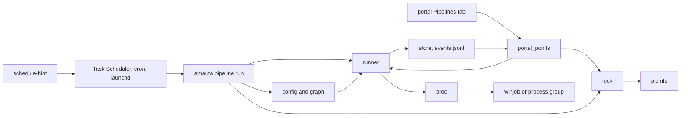
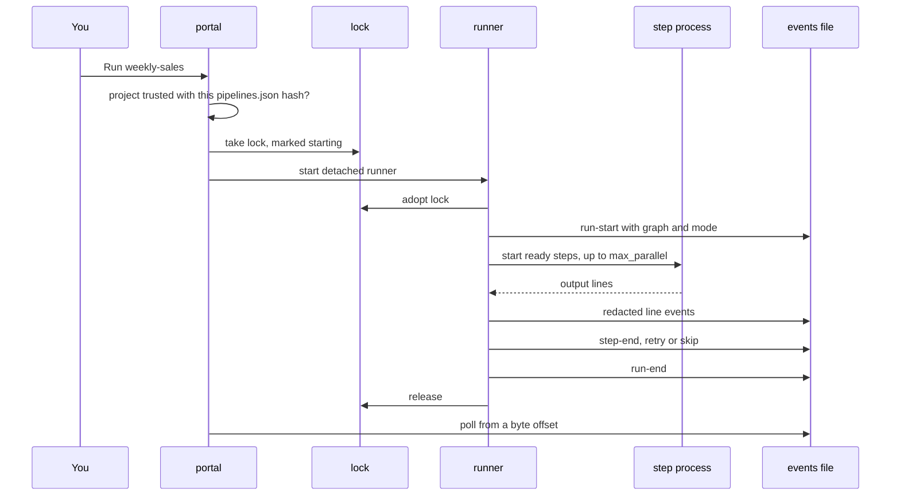

# The pipelines orchestrator

Pipelines run a project's recurring processes (queries, workbook refreshes, scripts, notebooks, reports) and show their output live, from the terminal or the portal (ADR 0010). Steps form a graph: steps that do not depend on each other run side by side, steps and whole pipelines can be reused, and modes switch steps on or off (ADR 0011). A step owns its processes, and one run of a pipeline happens at a time (ADR 0012). Pipelines are an extra: deleting `python/amauta/extras/pipelines/` removes the feature and nothing else.

## What it is made of

| Module | Role |
| --- | --- |
| `config.py` | Reads and checks `.amauta/pipelines.json`: steps, blocks, modes, schedules, limits; refuses a definition with a secret-like value |
| `graph.py` | Step ids, `needs`, blocks, sub-pipeline expansion, cycles and levels (pure functions) |
| `runner.py` | Runs one pipeline as a DAG, at most `max_parallel` steps at a time; retries, outputs, redaction, events |
| `proc.py` | One attempt of one step: argv without a shell, environment, output read in a thread, its process tree stopped |
| `winjob.py` | A Windows job object per step (kill-on-close), through `ctypes` |
| `pidinfo.py` | Whether a process id is alive and when it started, so a reused pid does not hold a lock |
| `lock.py` | One run at a time: `<pipeline>.lock`, taken atomically, adopted by the runner, stale when its process is gone |
| `store.py` | Where runs live, run summaries, the newest 50 runs kept per pipeline |
| `check.py` | `pipeline check`: what would stop a run, without running anything |
| `schedule.py` | `schedule-hint` entries for the OS scheduler, and whether a scheduled run was missed |
| `portal_points.py` | The portal side, reached through the extension registry |
| `__main__.py` | The CLI behind `amauta pipeline` |

## How the parts relate



## How you use it

Define pipelines in the project's `.amauta/pipelines.json`. A synthetic example:

```json
{
  "blocks": { "clean": { "type": "python", "script": "etl/clean.py", "retries": 1 } },
  "pipelines": [
    { "id": "weekly-sales", "name": "Weekly sales report", "category": "Sales",
      "max_parallel": 2, "modes": ["full", "quick"], "default_mode": "full",
      "schedule": [ { "at": "07:30", "days": ["mon"], "mode": "full" } ],
      "steps": [
        { "id": "orders", "use": "clean", "args": ["orders"] },
        { "id": "stores", "use": "clean", "args": ["stores"], "needs": [] },
        { "id": "model", "type": "r", "script": "analysis/model.R", "needs": ["orders", "stores"], "modes": ["full"] },
        { "id": "book", "type": "command", "argv": ["python", "tools/refresh_book.py"], "needs": ["model"],
          "outputs": ["out/sales.xlsx"], "timeout": 900 } ] } ] }
```

| Step type | Runs |
| --- | --- |
| `command` | `argv` exactly as listed: a list, never a shell string |
| `python` | `python3` (or `interpreter`) with `script` and `args` |
| `r` | `Rscript` (or `interpreter`) with `script` and `args` |
| `notebook` | `jupyter nbconvert --to notebook --execute`, writing `<name>.run.ipynb` beside the source |
| `pipeline` | Replaced at load by another pipeline's steps, named `<step id>.<inner id>` |

Per step, optionally: `id`, `needs`, `timeout` (seconds, default 3600), `cwd`, `enabled: false`, `retries` (0 to 5), `retry_delay` (seconds, default 30), `outputs` (files the step must write or change), `modes`, `use` (a block). Scripts, notebooks and outputs are relative to the project root and may not lead outside it, symlinks included.

- A step without `needs` waits for the step before it, so a plain list stays a line; `needs: []` starts it at once.
- A failure skips only the steps that need the failed one (reason `needs`); other branches finish and the run ends failed.
- A step outside the run's mode is skipped and counts as done.
- Database, workbook and mail steps are your own scripts: amauta has no drivers.

Then, in the portal, open **Projects > Pipelines**. Each card shows the steps by levels with their last duration and mark, the schedule and its state, the last run and the files it wrote, recent runs (click one to replay it), **Run** (asks first), **Check**, **Only this** per step and a mode picker. A project must be trusted first with `amauta check trust`, because a run executes its code.

## Scripts and commands

| Command | What it does |
| --- | --- |
| `amauta pipeline list [--cwd DIR]` | The project's pipelines |
| `amauta pipeline check [<id>]` | What would stop a run (missing script, program not found, bad `cwd`); exit 1 on an error |
| `amauta pipeline run <id> [--mode M] [--step N] [--python EXE]` | Run it, printing `[step] line`; exit 0 ok, 1 failed, 130 cancelled, 3 already running |
| `amauta pipeline status [--json]` | The last run of each pipeline |
| `amauta pipeline cancel <id>` | Stop the running step's whole process tree |
| `amauta pipeline schedule-hint <id> [--at HH:MM] [--day mon] [--os windows\|linux\|darwin]` | Print the OS scheduler entry; amauta registers nothing |
| `amauta check trust` | Trust the project, with the hash of its `pipelines.json` |

Every command also takes `--cwd DIR` and `--state-dir DIR`. Run files: `<state dir>/pipelines/runs/<project key>/<id>-<time>-<pid>.jsonl`, beside `<id>.lock`, and `.cancel` and `.log` files of the same name.

## How it works



**Events.** A run writes JSON lines: `run-start` (with the step ids, their `needs` and the mode), `step-start`, `line`, `step-retry`, `step-end` and `run-end`, plus who started it (`cli`, `portal` or `schedule`) and how long each step took. Every line is redacted through the detector catalog, plus a private key block from its BEGIN line to its END line. A secret printed in pieces can still get through, and a notebook's `.run.ipynb` keeps its outputs unredacted inside the project.

**Process ownership.** Each step runs in its own process group on Linux and macOS, or a job object on Windows. On a timeout or cancel all of them are stopped, and whatever the step left running is stopped when it ends. A process that left the group on purpose and keeps the output open is given up on two seconds later, with a line saying it was left running.

**One run at a time.** Whoever starts a run takes `<id>.lock` atomically: the portal, the terminal or a scheduled run. The lock records its process id and start time, so a dead or zombie process, or a different process that got the same pid, no longer holds it. A run whose runner stopped without ending it reads as abandoned. SIGTERM or Ctrl+C cancels the run and still writes its end.

**Environment.** Steps inherit the environment of whoever started the run, with your own `PYTHONPATH` (amauta's folder removed), plus `AMAUTA_PIPELINE`, `AMAUTA_PIPELINE_TRIGGER`, `AMAUTA_PIPELINE_STEP` and `AMAUTA_PIPELINE_MODE`. A script can, for example, send its mail only when the trigger is `schedule`.

**Trust by hash.** The browser sends only a project, a pipeline id, and a step number or a mode, never a command. The portal runs a pipeline only while `.amauta/pipelines.json` has the hash recorded by `amauta check trust`; after any change, yours or a `git pull`, review it and trust again. The CLI and the OS scheduler run what you asked for and need no trust.

**Schedules.** `schedule` is an object or a list: `{"at": "07:30"}`, with `days`, with `day_of_month` (1 to 28), or `{"every_minutes": 30}`, each optionally with a `mode`. `schedule-hint` prints a `schtasks /Create` line on Windows, a crontab line on Linux and a launchd agent on macOS, each running `amauta pipeline run <id> --trigger schedule --cwd <project>` with this terminal's `PATH`. The portal compares scheduled runs with the declared schedule and says when none has happened yet or one was missed, with 30 minutes of grace.

**Limits.** Steps run with your permissions and environment, keys included: amauta does not isolate them. `max_parallel` is 1 to 16 (default 4); a timeout is at most 24 hours. If the runner itself is killed outright, the running step keeps going on its own and the run reads as abandoned.

Related: [[guide:portal|The portal]], [[guide:code-security|Code security]] for trust, [[guide:extras|Optional modules and extras]] for how extras plug in.
