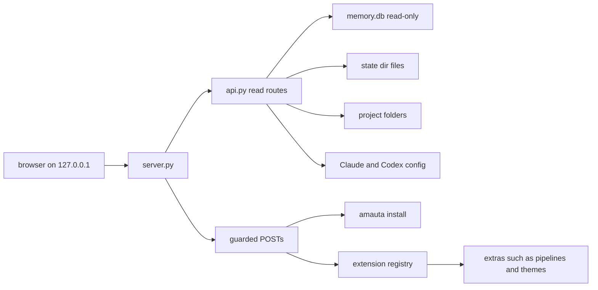
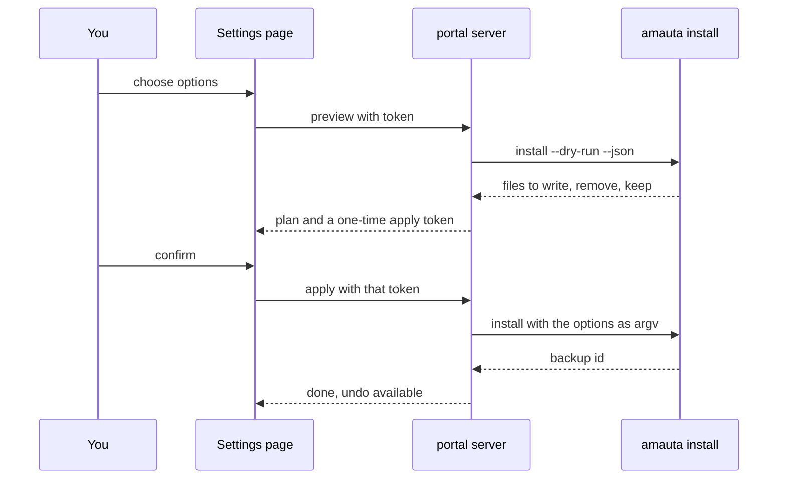

# The portal

The portal is a local wiki over everything the harness knows: memories, skills, tools, MCP servers, sessions, usage, ODD features, the code graph, pipelines, the security state and this guide. Each item is a linked page with backlinks. It is a stdlib Python server plus a plain JavaScript single-page UI, with no CDN and no network; it binds `127.0.0.1` only and runs on demand, never as a background service (ADR 0005).

## What it is made of

| Part | Where | Role |
| --- | --- | --- |
| Launcher and CLI | `src/portal/` (`cli.js`, `launch.js`, `launcher.js`, `windows.js`) | `amauta portal`, `portal launch`, `portal install-launcher` |
| Server | `python/amauta/portal/server.py` | Loopback HTTP, strict headers, token and origin checks on writes |
| API | `python/amauta/portal/api.py` | The read-only `GET /api/...` routes |
| Wiki | `wiki*.py` | Pages, search, backlinks, lint, the harness wiki, the home page |
| Projects, siblings | `projects.py`, `siblings.py`, `config.py` | Known projects from `portal.json`, `--repo` and session git roots; sibling health |
| Settings | `settings.py` | The guarded settings editor, which runs the installer |
| Security | `security.py` | The Security page: protections, checkers, trusted projects, profiles |
| Diagrams | `diagrams.py`, `archify.py`, `static/mermaid.min.js` | Server-generated Mermaid source; the vendored Mermaid build; archify when installed |
| Guide | `guide.py`, `guide/en/`, `guide/es/` | These pages |
| UI | `static/` | `app.js`, one `page-*.js` per page, `markdown.js` (the safe Markdown subset), `i18n/en.json` and `es.json`, `style.css` |

## How the parts relate



The sidebar has seven pages; their other routes show as tabs:

| Page | Tabs and routes |
| --- | --- |
| Home | `#/` recent activity by day; a rail with spending, skill impact and harness health |
| Projects | `#/project`, ODD features `#/feature`, Graph `#/node`, Pipelines `#/pipelines`; sibling cards |
| Memory | `#/memory`, Lint `#/lint` |
| Activity | Usage `#/usage`, Sessions `#/session`, Tools `#/tool`, MCP servers `#/mcp` |
| Harness | `#/harness`, Skills `#/skill`, Components `#/component`, Guide `#/guide` |
| Security | `#/security` |
| Settings | `#/settings`, Themes `#/themes` |

## How you use it

```bash
amauta portal                       # serves on 127.0.0.1, port 8765 by default
amauta portal launch                # an app window; the server stops when it closes
amauta portal install-launcher      # a desktop entry or Start menu shortcut
```

- Search with `Ctrl+K` or `/`: one query across memories (full-text), skills, tools, MCP servers, sessions, features, tasks and graph nodes.
- Use the Range, Project and Runtime filters above the pages that have them (All, Claude Code, Codex).
- Switch the theme (System, Light, Dark, your own themes) and the language (English, Spanish) at the foot of the sidebar. Your own text stays as written; dates are always `YYYY-MM-DD`.
- Add projects in Settings > Projects, or with `--repo DIR` (repeatable).
- Read this guide under Harness > Guide; each page follows the portal's language and falls back to English.

## Scripts and commands

| Command | What it does |
| --- | --- |
| `amauta portal [--port N] [--repo DIR]... [--claude-home DIR] [--engram-db FILE] [--state-dir DIR] [--idle-exit S]` | Start the server |
| `amauta portal launch [--idle-exit S]` | Free port, detached server, Chrome or Edge `--app` window with its own profile |
| `amauta portal install-launcher [--remove]` | `~/.local/share/applications/amauta-portal.desktop` on Linux, `amauta.lnk` in the Start menu on Windows |
| `PYTHONPATH=python python3 -P -m amauta.portal ...` | The same server without the CLI wrapper |

Files in the state directory the portal reads: `portal.json` (`repos`, `auto_discover`, `siblings`), `themes/*.json`, `prices.json` (cost estimates stay off without it), `wiki/` (cached tool descriptions, explanation requests and notes), `portal/run.json` and `portal/portal.log` for a launched server.

## How it works

### Reading

Every database is opened with `mode=ro`: never created, never migrated. Projects come from `--repo`, from `portal.json` and from the git roots of your sessions; auto-discovery only looks inside your home directory and skips linked git worktrees. Harness facts (hooks, MCP servers, agents, commands, plugins, output styles) are rebuilt from the real files on each request and cached for a couple of seconds; each component page names the source of each fact. MCP configs show command and argument shapes with secrets masked and only the names of environment variables.

Memory links are derived, since the store has no relation table: `[[wikilinks]]`, the `topic_key` hierarchy, whole-word mentions and graph labels. All text from memories, repositories and graphs goes through the safe Markdown subset as text nodes, under a strict Content-Security-Policy; there is no raw HTML.

### Writing

Writes go only through guarded POST endpoints: JSON only, size-capped, a per-process token, `Host` and `Origin` checks and closed schemas. They cover Refresh usage, the heartbeat, the settings editor, project and sibling configuration, graph sync and connect, tool description refresh, explanation requests, themes, and pipeline run and cancel.



The settings editor changes a closed list: persona, review mode, telemetry, the optional modules and reinstall or repair. The portal never edits a harness file itself. The apply token is valid five minutes and is bound to the chosen options and the `state.json` hash. **Undo** re-runs the install with the settings before the newest portal change; it never restores file snapshots.

### Diagrams

The portal ships an unmodified Mermaid build, loaded only when a diagram is first drawn, with `securityLevel: 'strict'`. Mermaid source for task progress, graph neighbourhoods and the harness architecture is generated server-side with generated ids and escaped, capped labels. Memories and guide pages draw their own Mermaid fences. With archify installed, the Harness page draws the architecture with it in a sandboxed frame.

### Extras in the portal

Some tabs come from extras through the extension registry: the Pipelines tab ([[guide:pipelines|The pipelines orchestrator]]), the theme editor, skill impact and wiki explanations ([[guide:extras|Optional modules and extras]]). Deleting an extra's folder removes its tab or block and nothing else.

### Launcher

`portal launch` starts the server detached and opens a browser window. The page sends a heartbeat every 10 seconds; a launched server exits once heartbeats stop (`--idle-exit`, 30 seconds by default). A second launch reuses the running server.

See also [[guide:siblings|Sibling projects]] for the sibling cards and [[guide:data-security|Data security]] for what the Security page reports.
