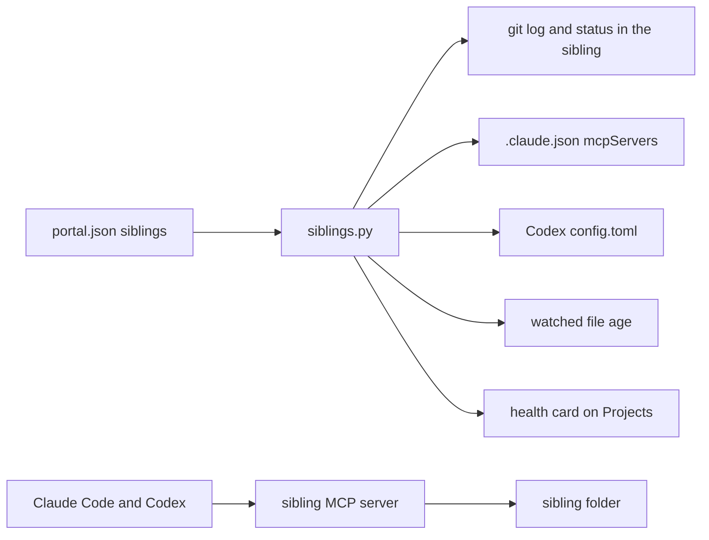
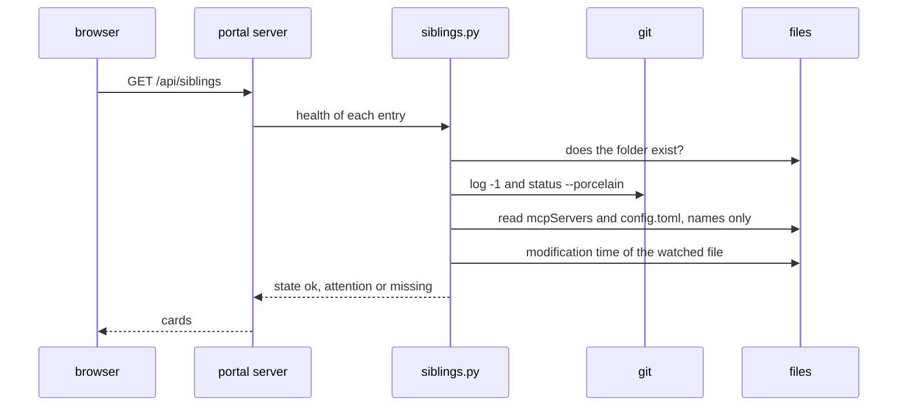

# Sibling projects

A sibling project is a project that lives beside amauta, in its own repository, with its own dependencies and its own release rhythm. amauta does not import it, install it or run it: the portal only links it and checks its health (ADR 0001). Typical siblings are a data catalog or an ETL repository that you use together with Claude Code or Codex.

## What it is made of

| Part | Where | Role |
| --- | --- | --- |
| Sibling entries | `<state dir>/portal.json`, key `siblings` | A closed list of at most 20 entries |
| Validation and health | `python/amauta/portal/siblings.py` | Checks each entry; reads git, the MCP registrations and one watched file |
| Settings form | Settings > Sibling projects in the portal | Edit the list through a guarded POST |
| Health cards | the Projects page, `GET /api/siblings` | One card per sibling with a mark |
| The sibling itself | anywhere on your disk | Its own code, tests, dependencies and, often, its own MCP server |

An entry has these keys, and no others:

| Key | Required | Meaning |
| --- | --- | --- |
| `name` | yes | 1 to 60 characters, shown on the card |
| `path` | yes | The sibling's folder; the same path rules as configured projects (not `/`, not your home itself, not system folders) |
| `mcp` | no | The name of the sibling's MCP server, as registered in Claude Code and Codex |
| `watch` | no | A relative path inside the sibling whose age tells how fresh it is (an export, a catalog cut) |
| `max_age_days` | no | 1 to 366; the watched file is stale after that many days |

## How the parts relate



The runtimes talk to the sibling directly, through its own MCP server that you register like any other. amauta stands to the side: it syncs that MCP entry between Claude Code and Codex like any other stdio server ([[guide:install|Install and runtimes]]) and shows whether both runtimes have it.

## How you use it

1. Keep the sibling in its own folder and repository, with its own setup.
2. Register its MCP server in Claude Code or Codex if it has one; `amauta sync` copies a stdio entry to the other runtime.
3. Add it in Settings > Sibling projects, or edit `portal.json`:

```json
{
  "siblings": [
    { "name": "Data catalog", "path": "/home/you/code/data-catalog", "mcp": "catalog",
      "watch": "catalog/CURRENT", "max_age_days": 35 }
  ]
}
```

4. Open the Projects page. Each card shows the last commit and the count of uncommitted changes, whether the MCP server named in `mcp` is registered for Claude (`.claude.json`) and for Codex (`config.toml`), and the age of the watched file.

The mark says what needs attention:

| Mark | Meaning |
| --- | --- |
| ✓ | Fine |
| ▲ | Attention: uncommitted changes, the MCP server registered in neither runtime, or the watched file missing or stale |
| ✗ | The folder is missing |

### An example: a data catalog such as oga_catalog

A data catalog is a good sibling. Picture a project like oga_catalog: a local catalog of datasets, tables and metric definitions that people approve by hand before a new cut becomes the current one, plus a small read-only MCP server so an agent can look things up without touching the sources. It needs its own libraries and its own release steps, so it stays outside amauta. The sibling entry points at its folder, names its MCP server, and watches the file that marks the current approved cut, so the card turns to attention when the catalog has not been refreshed in time. Everything else, including how the catalog is built and approved, is the sibling's own business.

## Scripts and commands

amauta has no sibling command of its own; you use the portal and the commands you already have.

| Command or file | Use |
| --- | --- |
| `amauta portal`, Projects page | The health cards |
| Settings > Sibling projects | Edit the list |
| `<state dir>/portal.json` | The same list as a file: `{"repos": [...], "auto_discover": true, "siblings": [...]}` |
| `GET /api/siblings` | The health data as JSON (read-only) |
| `amauta sync` | Copy the sibling's stdio MCP entry between Claude Code and Codex |
| `amauta status` | Lists MCP servers present in one runtime and not the other |

## How it works



The portal reads the sibling's folder and those two configuration files only. It runs `git` in the sibling with a 10-second timeout, reads the time of one file, and looks for the MCP server's name in the two configs without reading the server's command or environment. Entries are validated with a closed schema: unknown keys, an absolute or parent-relative `watch`, or an MCP name with odd characters are refused; a bad entry in the file is dropped.

### Why amauta never runs sibling code

- **Dependencies.** Siblings need libraries amauta must not carry: amauta stays plain Node.js and stdlib Python, with no npm dependencies (ADR 0001 rejected pulling siblings in as modules for this reason).
- **Trust.** Running another project's code from the portal would execute code you did not ask for; amauta keeps that for pipelines only, behind `amauta check trust` and a hash of the definition ([[guide:pipelines|The pipelines orchestrator]]).
- **Ownership.** The sibling decides how it is built, tested and released; amauta only tells you whether it looks healthy.

If you want amauta to run a sibling's job on a schedule, define a pipeline in a project you trust whose `command` step calls the sibling's own script. Back to [[guide:overview|amauta at a glance]].
