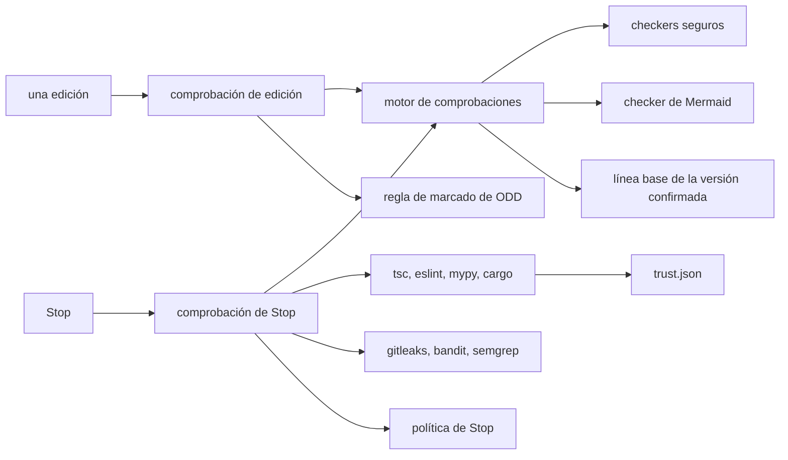
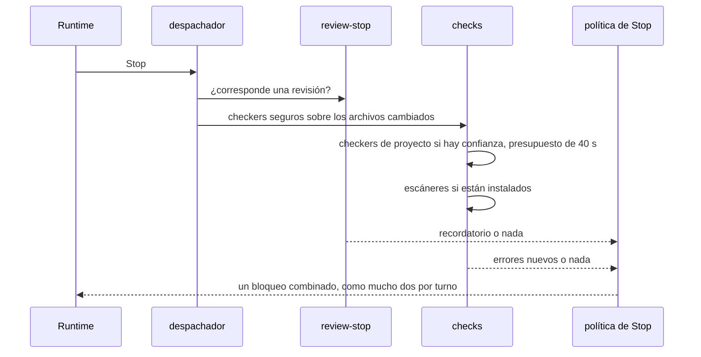

# Seguridad de código

El pilar de seguridad de código le da al agente una retroalimentación al estilo de un compilador: después de una edición ve líneas `file:line:col: error: message [checker]` y las corrige en el mismo turno, y en Stop se vuelven a comprobar los archivos cambiados del repositorio (ADR 0006). Solo cuentan los errores que añadió el cambio, porque cada archivo se compara con su última versión confirmada. Los checkers que ejecutan código del repositorio solo se ejecutan en un proyecto en el que confiaste.

## De qué está hecho

| Parte | Dónde | Papel |
| --- | --- | --- |
| Motor de comprobaciones | `src/checks/engine.js` (núcleo) | Un solo formato de hallazgo, un tiempo límite por checker, la línea base de la versión confirmada |
| Checkers seguros | `src/checks/safe.js` | JSON en el proceso, JavaScript con `node --check`, Python con `ast.parse`, TOML con `tomllib`, shell con `bash -n`, valores que parecen secretos mediante el catálogo de detectores |
| Checker de Mermaid | `src/mermaid/check.js`, `src/mermaid/cli.js` (el módulo `code-security`) | Cada bloque Mermaid en Markdown, analizado por el Mermaid vendorizado sin navegador |
| Checkers de proyecto y escáneres | `src/checks/project.js` | `tsc`, `eslint`, `mypy`, `cargo check` (necesitan confianza); `gitleaks`, `bandit`, `semgrep` (solo leen código) |
| Confianza | `src/checks/trust.js`, `src/checks/cli.js` | `amauta check trust\|untrust\|status`, guardado en `<state dir>/checks/trust.json` |
| Lado del hook | `src/hooks/checks.js` | La comprobación de edición, la comprobación de Stop y la regla de marcado de ODD |

amauta no instala ningún checker: se buscan en `node_modules/.bin` o en el `PATH`, y se omiten si faltan.

## Cómo se relacionan las partes



## Flujo de uso y de trabajo

Casi siempre no haces nada: la instalación activa las comprobaciones (`amauta install --no-checks` las desactiva).

- **Después de una edición** en Claude Code (`PostToolUse` en `Edit`, `Write`, `MultiEdit`, `NotebookEdit`), se ejecutan los checkers seguros para el tipo del archivo. Los errores nuevos vuelven como un bloque de líneas de hallazgo, así que el agente los corrige en el mismo turno. Un checker que no puede arrancar o que tarda más de 10 segundos se omite.
- **En Stop** (ambos runtimes), los mismos checkers seguros se ejecutan sobre cada archivo cambiado del repositorio según `git status`, lo que incluye las ediciones hechas a través del shell o por Codex. En un proyecto de confianza también se ejecutan los checkers de proyecto, si están configurados e instalados, y los escáneres de seguridad se ejecutan si están instalados.
- **Confía en un proyecto** cuando estés de acuerdo con que se ejecuten sus propias herramientas:

```bash
cd ~/code/weekly-sales
amauta check status      # qué checkers aplican aquí y si el proyecto es de confianza
amauta check trust       # permite tsc, eslint, mypy y cargo en Stop, y las ejecuciones de pipelines del portal
amauta check untrust
```

- **Comprueba los diagramas** de la documentación tú mismo:

```bash
amauta mermaid check docs/architecture.md README.md
```

## Scripts y comandos

| Comando | Qué hace |
| --- | --- |
| `amauta check trust [--cwd DIR] [--state-dir DIR]` | Confía en la raíz git de DIR; registra el sha256 de su `.amauta/pipelines.json` |
| `amauta check untrust [--cwd DIR]` | La quita de la lista |
| `amauta check status [--cwd DIR]` | Los checkers que aplican y el estado de confianza |
| `amauta mermaid check FILE.md...` | Valida cada bloque Mermaid; sale con 1 y `file:line` ante un error de sintaxis |
| `amauta install --no-checks` | Instala sin las comprobaciones de edición y de Stop |

| Checker | Necesita | Se ejecuta cuando |
| --- | --- | --- |
| `tsc` | confianza, `tsconfig.json` | cambiaron archivos TypeScript |
| `eslint` | confianza, una configuración de eslint | cambiaron archivos JavaScript o TypeScript |
| `mypy` | confianza, `mypy.ini` | cambiaron archivos Python |
| `cargo check` | confianza, `Cargo.toml` | cambiaron archivos Rust |
| `gitleaks` | estar instalado | cualquier archivo, con la salida redactada |
| `bandit` | estar instalado | archivos Python |
| `semgrep` | estar instalado, el `.semgrep.yml` propio del proyecto | cualquier archivo, métricas desactivadas, nunca `--config auto` |

## Cómo trabaja

### La línea base

Para cada archivo, el motor ejecuta los checkers sobre el texto actual y sobre la última versión confirmada (`git show HEAD:<file>`, en un directorio temporal), y luego conserva solo los hallazgos que añadió la edición, emparejados por checker y mensaje para que las líneas movidas no cuenten como nuevas. Un archivo nuevo no tiene línea base: cuenta cada error. No se guarda nada en caché a nivel de proyecto.

### Confianza

`tsc`, `eslint`, `mypy` y `cargo` cargan la configuración, los plugins y los scripts de build propios del proyecto, así que ejecutan código del repositorio. Solo se ejecutan en un proyecto listado en `trust.json`. Los escáneres solo leen código y no necesitan confianza. La misma entrada de confianza cubre los pipelines: registra el hash de `.amauta/pipelines.json`, y el portal ejecuta los pipelines de un proyecto solo mientras ese archivo sea el mismo en el que confiaste ([[guide:pipelines|El orquestador de pipelines]]).

### La comprobación de Stop y la política de Stop



Los checkers de proyecto comparten un presupuesto de 40 segundos dentro del único hook de Stop, cuyo tiempo límite es de 60 segundos como el de cualquier otro hook. Solo se informan los errores en archivos cambiados. El recordatorio de revisión y las comprobaciones pasan por una sola política de Stop: un bloqueo combinado, y como mucho dos bloqueos mientras el runtime sigue adelante por un hook de Stop. Una parada natural reinicia el conteo.

### La regla de marcado de ODD

Cuando una edición de `odd/tasks/*.md` marca un ítem como hecho (comparada con la versión confirmada) mientras los archivos cambiados del repositorio tienen errores, la comprobación de edición responde con un bloqueo que nombra los ids de las tareas y los errores: corrígelos o deja la tarea abierta. Consulta [[guide:odd|ODD y revisión]].

### Secretos y Mermaid

El checker de secretos ejecuta `python3 -P -m amauta.detectors secrets FILE` sobre cualquier archivo de texto e informa línea y columna, nunca el valor; los archivos binarios y los de más de 1 MiB se omiten. El checker de Mermaid ejecuta `mermaid.parse()` en Node simple, dentro de un contexto `node:vm` desnudo y sin DOM. Solo comprueba la sintaxis; el diseño y el renderizado todavía necesitan un navegador, como el portal. La comprobación de Stop también valida los bloques Mermaid y busca secretos en los entregables cambiados.

Las ediciones de Codex llegan como parches a través de su shell, así que Codex todavía no tiene comprobación de edición; recibe la comprobación de Stop. Relacionado: [[guide:data-security|Seguridad de datos]] para el catálogo de detectores, [[guide:kernel|El núcleo]] para el despachador.
