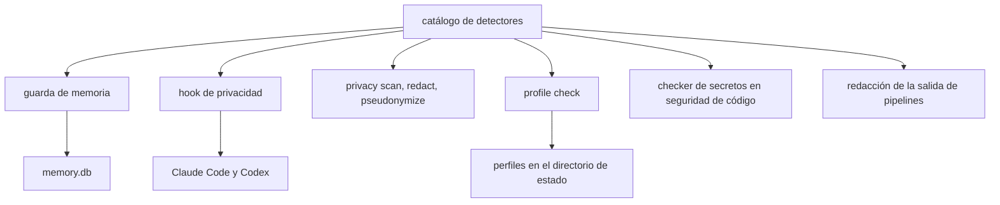
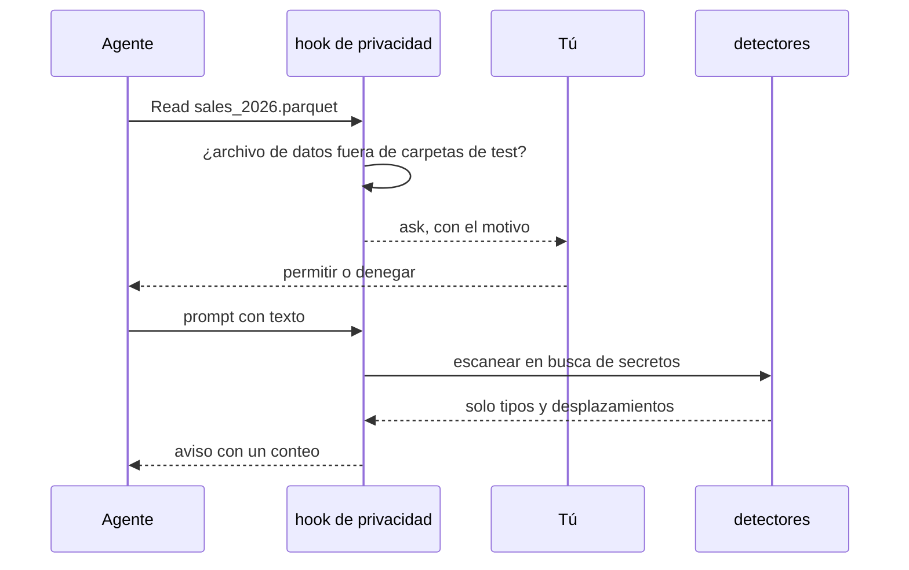
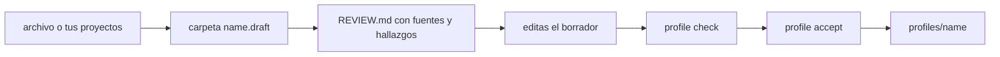

# Seguridad de datos

El pilar de seguridad de datos evita que los datos sensibles y los secretos lleguen por accidente al modelo, a la memoria o a un repositorio. Es fricción, no aislamiento (ADR 0007): amauta no tiene sandbox y no pretende tenerlo. Pregunta antes de leer un archivo de datos, avisa cuando un prompt contiene un secreto, rechaza secretos en la memoria y te da herramientas locales para escanear, redactar y seudonimizar datos. El conocimiento de la organización vive en perfiles privados en tu máquina, nunca en un repositorio.

## De qué está hecho

| Parte | Dónde | Papel |
| --- | --- | --- |
| Catálogo de detectores | `python/amauta/detectors/` (núcleo) | Patrones de secretos y validadores de identificadores: cédula y RUC con dígitos verificadores, tarjetas por Luhn, IBAN, correo electrónico, teléfonos. Un solo escaneo de texto cuyos hallazgos llevan un tipo y desplazamientos, nunca el valor |
| Guarda de memoria | `python/amauta/memory/guard.py` (núcleo) | Siempre activa: rechaza el texto que parece un secreto, reemplaza los identificadores por `[REDACTED_<KIND>]` |
| Hook de privacidad | `python/amauta/privacy/hook.py` | Pregunta antes de leer un archivo de datos; avisa de un secreto en un prompt; nunca deniega |
| CLI de privacidad | `python/amauta/privacy/__main__.py`, `columns.py`, `pseudonymize.py` | `amauta privacy scan\|redact\|pseudonymize` |
| Reglas de archivos de datos | `python/amauta/privacy/paths.py` | Qué archivos cuentan como archivos de datos, más tus propias rutas |
| Perfiles | `python/amauta/privacy/profiles.py`, `profile_import.py`, `assets/profiles/default/` | El perfil neutro por defecto y los perfiles privados de organización |

El mismo catálogo sirve también a la seguridad de código (secretos en archivos editados) y a los pipelines (redacción de líneas de salida).

## Cómo se relacionan las partes



## Flujo de uso y de trabajo

### El hook de privacidad

En Claude Code, el hook se ejecuta en `PreToolUse` para `Read`, `NotebookRead` y `NotebookEdit`. Cuando el archivo parece un archivo de datos responde **ask**: el runtime te muestra el motivo y tú decides. Los archivos de datos son archivos CSV, TSV, Excel, Parquet, SPSS, Stata, SAS, datos de R, JSON Lines, SQLite y Access fuera de las carpetas `test`, `fixture`, `example` y `sample`, más todo lo que esté bajo las rutas que listes en `<state dir>/privacy.json`:

```json
{ "paths": ["/data/exports"] }
```

En `UserPromptSubmit` (ambos runtimes) escanea el prompt en busca de secretos y muestra un aviso con un conteo; el prompt ya se envió, así que rota una clave real. Nunca deniega y nunca repite el texto que encontró. Codex lee archivos a través de su shell, así que solo recibe la comprobación del prompt. Desactiva el hook con `amauta install --no-privacy`.

### La guarda de memoria

No la llamas tú. Cada título, contenido, prompt y resumen de sesión que escribe la memoria pasa por ella. El texto que parece un secreto (claves de API, tokens bearer, claves privadas, claves de la nube, `password=...`) se rechaza con la respuesta fija `rejected: secret-like content` y no se escribe nada. Los identificadores se reemplazan por marcadores, y la respuesta de la herramienta dice cuántos hay de cada tipo, nunca cuáles. La página de Seguridad del portal muestra cuántos valores se redactaron.

### Trabajar con un archivo de datos

```bash
amauta privacy scan orders.csv notes.txt          # tipos, líneas, columnas con identificadores; sale con 1 si encuentra algo
amauta privacy redact notes.txt -o notes.redacted.txt
amauta privacy pseudonymize orders.csv --columns customer_id,email -o orders.pseudo.csv
```

`scan` puede servir de filtro para un commit porque sale con 1 ante un hallazgo. `redact` escribe una copia con marcadores y nunca cambia el original. `pseudonymize` reemplaza cada valor de las columnas CSV indicadas por `<COLUMN>_<12 hex>` a partir de un hash con clave; el mismo valor da el mismo seudónimo, así que los joins siguen funcionando. La clave son 32 bytes aleatorios en `<state dir>/privacy.key` (modo 0600), creada una vez y nunca impresa. Un seudónimo no es anonimato: otras columnas todavía pueden identificar a una persona.

### Perfiles

Un perfil dice cómo es el trabajo de una organización sin ponerlo en un repositorio:

| Archivo | Contiene |
| --- | --- |
| `brand.md` | Paleta, fuentes, logo y nombres de archivos de plantilla |
| `conventions.md` | Nombres, estilo de código y de SQL, formatos de fecha y número, idioma de los entregables |
| `glossary.md` | Términos aprobados y definiciones de métricas |
| `sources.md` | Fuentes de datos por propósito y rol responsable; nunca hosts, cadenas de conexión ni credenciales |
| `people/roles.md` | Solo roles; nunca nombres, direcciones de correo ni números de teléfono |

Capas, por archivo gana la primera coincidencia: el proyecto (`<repo>/.amauta/profile/<file>`), el perfil de organización seleccionado (`<state dir>/profiles/<name>/`) y luego el `default` neutro incluido. La selección se guarda por raíz git en `<state dir>/profiles/selection.json`, así que el nombre de una organización nunca termina en un repositorio.

## Scripts y comandos

| Comando | Qué hace |
| --- | --- |
| `amauta privacy scan [--json] FILE...` | Informa identificadores y secretos: conteos, líneas, columnas; nunca valores |
| `amauta privacy redact FILE -o OUT` | Una copia redactada de un archivo de texto |
| `amauta privacy pseudonymize FILE --columns A,B -o OUT [--state-dir DIR]` | Una copia CSV con seudónimos con clave |
| `amauta profile list` | Los perfiles de esta máquina |
| `amauta profile new <name>` | Un perfil privado a partir de los archivos por defecto |
| `amauta profile use <name> [--cwd D]` | Lo selecciona para el proyecto que contiene D; `use default` quita la selección |
| `amauta profile show [--cwd D]` | Qué archivo viene de qué capa |
| `amauta profile check <name>` | La guarda de privacidad sobre un perfil: secretos, identificadores, contactos, nombres en `people/`; sale con 1 ante un hallazgo |
| `amauta profile import <name> <archive>` | Un borrador a partir de un archivo de un agente |
| `amauta profile harvest <name> --from DIR` | Un borrador a partir de tus proyectos: temas de Power BI, medidas de modelos, guías de contribución y de estilo |
| `amauta profile accept <name>` | Instala el borrador revisado; se rechaza mientras la guarda encuentre algo |

## Cómo trabaja



Cada parte consulta el mismo catálogo y recibe tipos y desplazamientos, así que ninguna herramienta tiene que imprimir un valor para informarlo. El hook falla en abierto: ante cualquier error no imprime nada y la lectura sigue como siempre.

Los perfiles pasan primero por un borrador:



`import` y `harvest` escriben `<state dir>/profiles/<name>.draft/` y un `REVIEW.md` que lista cada fuente con su destino, los archivos omitidos (código y datos; los archivos de datos nunca se abren) y los hallazgos de la guarda por archivo, línea y tipo. `accept` conserva un perfil existente como `<name>.bak-<time>`. Un perfil nunca se sincroniza, ni se enlaza en una carpeta de skills, ni se publica. Los fixtures de los tests son generados, nunca reales.

Relacionado: [[guide:code-security|Seguridad de código]] para los secretos en el código editado, [[guide:kernel|El núcleo]] para el almacén de memoria, [[guide:pipelines|El orquestador de pipelines]] para la redacción de la salida.
