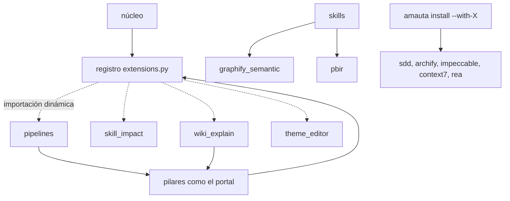
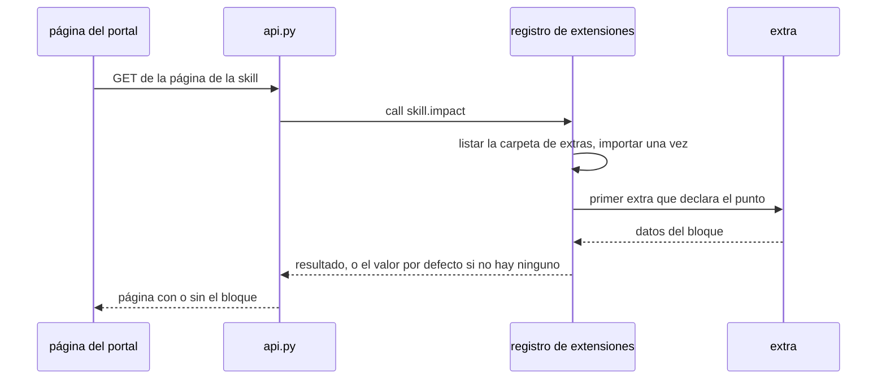

# Módulos opcionales y extras

Más allá del núcleo y los cuatro pilares, amauta tiene dos tipos de añadidos. Los **módulos opcionales** se instalan solo cuando los pides (`amauta install --with-<module>`) y se quitan con `--without-<module>` o `uninstall`. Los **extras** son código bajo `python/amauta/extras/` que el núcleo y los pilares nunca importan: llegan a él a través del registro de extensiones, así que borrar la carpeta de un extra quita su función y nada más (ADR 0009).

## De qué está hecho

### Módulos opcionales

| Módulo | Opción | Qué obtienes |
| --- | --- | --- |
| `sdd` | `--with-sdd` | Desarrollo guiado por especificaciones: skills y agentes `sdd-*`, comandos renombrados a `/amauta-sdd-*`, un módulo de estado de solo lectura y el hook de preflight de SDD |
| `archify` | `--with-archify` | La skill de diagramas archify vendorizada: el agente escribe JSON tipado, `bin/archify.mjs` genera un diagrama HTML autocontenido; la página del Arnés del portal también la usa |
| `impeccable` | `--with-impeccable` | La skill de diseño impeccable vendorizada (`craft`, `shape`, `critique`, `audit`, `polish`, `live` y más) y su motor con versión fija, instalado con `npm` una sola vez |
| `context7` | `--with-context7` | Una entrada de servidor MCP de terceros que se ejecuta mediante `npx` |
| `rea` | `--with-rea` | Una entrada de servidor MCP de terceros que se ejecuta mediante `npx` (lista unas 300 herramientas) |

Los cinco están desactivados por defecto y son persistentes hasta que los desactives. `context7` y `rea` se ejecutan sin sandbox y usan la red, por eso son opcionales.

### Extras

| Extra | Carpeta | Puntos de extensión | Qué hace |
| --- | --- | --- | --- |
| Pipelines | `extras/pipelines/` | `GET /api/pipelines`, `GET /api/pipelines/events`, `GET /api/pipelines/check`, `pipelines.run`, `pipelines.cancel` | Ejecuta los procesos de un proyecto; la pestaña Pipelines ([[guide:pipelines|El orquestador de pipelines]]) |
| Impacto de skills | `extras/skill_impact/` | `home.impact`, `skill.impact` | Compara las sesiones que cargaron una skill con las que no; comparativo, no causal |
| Explicaciones de la wiki | `extras/wiki_explain/` | `harness.explain`, `harness.pending`, `lint.categories`, `portal.explain_request` | Peticiones en cola de una explicación escrita de un componente del arnés, y las notas que Claude escribe de vuelta |
| Editor de temas | `extras/theme_editor/` | `themes.list`, `themes.write`, `themes.delete` | Temas claros y oscuros personalizados en `<state dir>/themes/*.json` |
| Graphify semántico | `extras/graphify_semantic/` | ninguno | La pasada semántica sin clave de API de la skill `graphify-semantic`, más archivos Markdown complementarios para presentaciones de PowerPoint |
| Herramientas PBIR | `extras/pbir/` | ninguno | Lint, diff, diccionario de datos, auditoría de diseño, referencias rotas a campos, un renombrado estructural y un archivo de tema para proyectos de Power BI, usadas por la skill `powerbi-report` |

## Cómo se relacionan las partes



Capas, según `MODULES.json`: los módulos opcionales solo importan el núcleo; un extra puede importar el núcleo y los pilares; nada importa un extra de forma estática, y `test/architecture.test.js` falla si algo lo hace. Los extras sin puntos de extensión (graphify semántico, herramientas PBIR) se alcanzan como módulos de línea de comandos desde sus skills.

## Flujo de uso y de trabajo

### Añadir o quitar un módulo opcional

```bash
amauta install --with-sdd --with-archify     # añadir
amauta install --without-archify             # volver a quitar uno
amauta status                                # muestra lo instalado y comprueba la CLI de archify y el motor de impeccable
```

También puedes cambiar los módulos en la página de Ajustes del portal, que ejecuta la misma instalación con una vista previa ([[guide:portal|El portal]]). Deshacer un cambio que desactivó `impeccable` no recupera su motor; ejecuta reinstalar o reparar.

### SDD

SDD se usa solo cuando lo pides o aceptas una propuesta; el tamaño o el riesgo por sí solos nunca lo eligen. Los comandos `/amauta-sdd-*` trabajan sobre `openspec/changes/<change>/`. Antes de despachar un subagente `sdd-*`, el agente principal debe hacer el preflight de tres preguntas y tú debes responderlo; luego el hook añade el bloque de preflight al prompt. Es el único hook que falla en cerrado, solo para los despachos `sdd-*`.

### Usar los extras

- **Pipelines**: `amauta pipeline ...` y la pestaña Proyectos > Pipelines.
- **Impacto de skills**: el panel lateral de Inicio y cada página de skill; un lado con menos de 5 sesiones muestra "no hay datos suficientes".
- **Explicaciones de la wiki**: pulsa Pedir explicación en la página de un componente y luego pide a Claude Code que procese las peticiones de explicación de la wiki (skill `amauta-wiki-explain`).
- **Editor de temas**: Ajustes > Temas, con vista previa en vivo, avisos de contraste, importación y exportación.
- **Graphify semántico**: pide una pasada semántica; la skill planifica fragmentos y despacha un subagente extractor de solo lectura por fragmento.
- **Herramientas PBIR**: la skill `powerbi-report` las llama sobre un proyecto PBIP.

### Añadir un extra propio

1. Crea `python/amauta/extras/<name>/__init__.py` con un comentario de cabecera y `POINTS = {"point.name": function}`.
2. Usa solo puntos de extensión que el núcleo o un pilar ya llamen (listados en `docs/modules.md`), o ninguno para un extra de línea de comandos.
3. Importa el núcleo y los pilares según lo necesites; nunca hagas que un módulo del núcleo o de un pilar importe tu extra.
4. Mantente dentro de los límites de simplicidad (archivo de 400 líneas, función de 60, línea de 140) y añade tests.

Para quitar un extra, borra su carpeta: su pestaña, bloque o comando desaparece y todo lo demás sigue funcionando.

## Scripts y comandos

| Comando | Qué hace |
| --- | --- |
| `amauta install --with-sdd\|rea\|context7\|impeccable\|archify` | Añade un módulo opcional |
| `amauta install --without-<module>` | Lo quita |
| `amauta sdd status [change] [--cwd DIR] [--json] [--instructions]` | Estado de SDD sobre `openspec/changes/` (solo lectura) |
| `amauta sdd continue [change]` | El siguiente paso de SDD (solo lectura) |
| `amauta pipeline list\|check\|run\|status\|cancel\|schedule-hint` | El extra de pipelines |
| `amauta py amauta.extras.pbir lint MODEL` | Reglas de DAX y del modelo como avisos |
| `amauta py amauta.extras.pbir diff OLD NEW` | Tablas, columnas y medidas añadidas, quitadas o cambiadas |
| `amauta py amauta.extras.pbir dictionary MODEL` | Un diccionario de datos en Markdown |
| `amauta py amauta.extras.pbir layout REPORT` | Visuales fuera de la página, superpuestos o demasiado pequeños; sale con 1 si hay alguno |
| `amauta py amauta.extras.pbir refs REPORT MODEL` | Campos, filtros y ordenaciones del informe que el modelo no tiene; sale con 1 si hay alguno |
| `amauta py amauta.extras.pbir rename REPORT --table T --from OLD --to NEW [--apply]` | Renombrado estructural; una prueba en seco a menos que pases `--apply` |
| `amauta py amauta.extras.pbir theme --name N (--colors C,... \| --brand FILE \| --profile) --out FILE.json` | Un archivo de tema a partir de una paleta, para importarlo en Desktop; nunca sobre un archivo existente sin `--force` |
| `python3 -P -m amauta.extras.graphify_semantic plan\|save-chunk\|validate\|merge` | Los pasos de la pasada semántica |
| `python3 -P -m amauta.extras.wiki_explain list` y `write --kind K --id I --file note.md` | Procesa las peticiones de explicación |

## Cómo trabaja



El registro (`python/amauta/extensions.py`) lista `python/amauta/extras/`, importa una vez cada paquete que tenga un `__init__.py` y lee sus `POINTS`. `call(point, ...)` devuelve la respuesta del primer extra o un valor por defecto; `collect(point, ...)` devuelve todas las respuestas. Un extra que no se puede importar no aporta puntos, así que un extra roto no puede romper el portal.

Los módulos opcionales funcionan en cambio a través del instalador: cada elección `--with-X` se registra en el estado de la instalación, se genera en el almacén de skills y en los enlaces como las demás skills, y se quita con `--without-X` o `uninstall`. Los módulos vendorizados (archify, impeccable) conservan su licencia original y sus sumas de verificación en `NOTICE` y `assets/manifest.json`; la comprobación de actualizaciones de archify está desactivada de forma permanente, e impeccable tiene la versión fija en la última línea de JavaScript puro (3.x).

Volver a [[guide:overview|amauta de un vistazo]].
