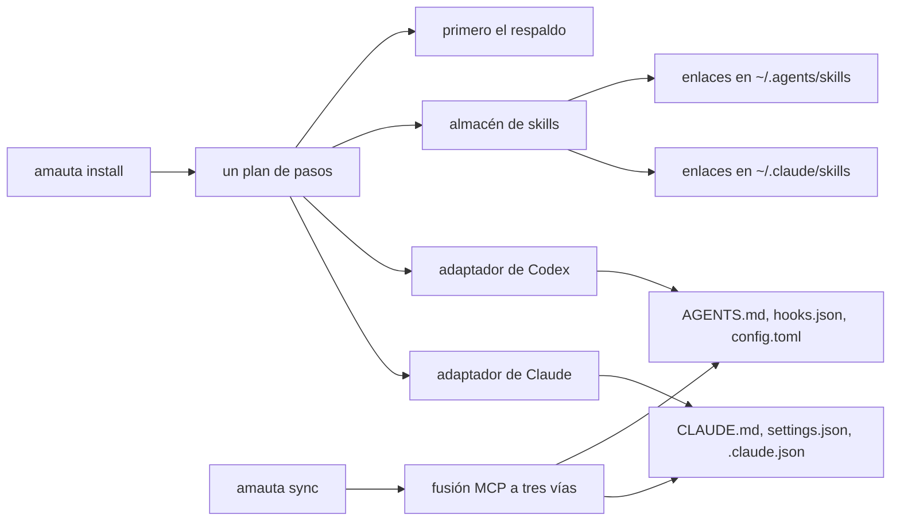
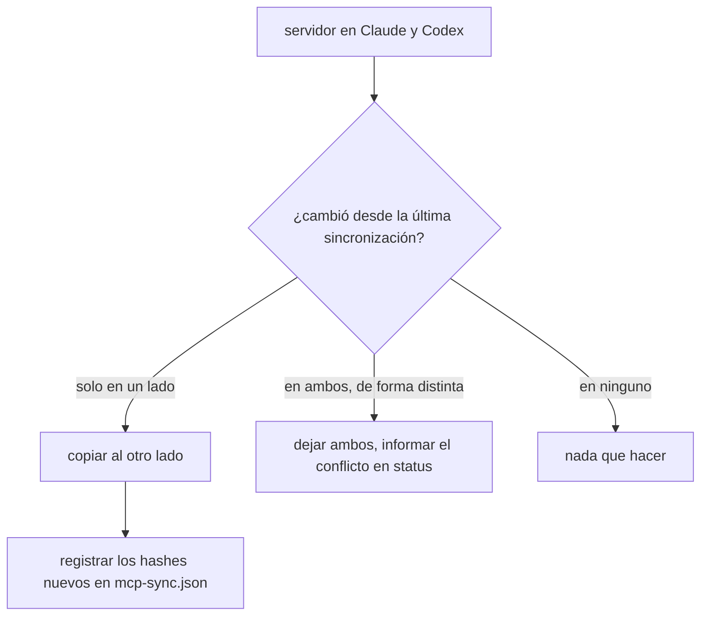

# Instalación y runtimes

`amauta install` prepara el arnés para Claude Code, para Codex o para ambos. Claude Code y Codex comparten un solo arnés y ninguno es el maestro: una memoria, un almacén de skills, servidores MCP sincronizados en ambos sentidos, y los mismos bloques de instrucciones y comandos de hooks escritos en cada uno.

## De qué está hecho

| Pieza | Dónde va | Notas |
| --- | --- | --- |
| Bloques de instrucciones siempre activos | `~/.claude/CLAUDE.md` y `~/.codex/AGENTS.md` | Cuatro bloques entre marcadores `<!-- amauta:ID -->`: `codegraph-guidance`, `persona`, `engram-protocol`, `orchestrator`. Tu propio texto se conserva |
| Hooks | `~/.claude/settings.json` y `~/.codex/hooks.json` | Un comando despachador por evento, cada uno con un tiempo límite |
| Servidores MCP | `~/.claude.json` y `~/.codex/config.toml` | `engram` (la memoria, o `amauta-memory`), `amauta`, `codegraph` cuando se encuentra en el `PATH`, `context7` y `rea` solo si los pides |
| Skills | `<state dir>/skills/<name>`, enlazadas desde `~/.claude/skills/` y `~/.agents/skills/` | Se generan una vez en el almacén |
| Agentes, estilo de salida | `~/.claude/` | Solo Claude: lentes de revisión, `chasqui`, `taripaq`, `haravec`, los agentes de judgment-day, el estilo de salida de la persona elegida |
| Permisos | `~/.claude/settings.json` | `ask` para force pushes, hard resets y `rm -rf`; `deny` para leer y editar `.env`, claves y archivos de credenciales. Sin `defaultMode`, sin entradas allow |
| Estado | `<state dir>/state.json`, `codex-state.json`, `mcp-sync.json` | Qué se instaló, hashes de los archivos gestionados, el último conjunto MCP sincronizado |
| Respaldos | `<state dir>/backups/<timestamp>/` | Se toman antes de cada escritura |

El código vive en `src/install/`: `installer.js` (el destino Claude y el plan), `codex.js` (el destino Codex), `steps.js` (pasos del plan compartidos por ambos, ADR 0002), `skillstore.js`, `mcpsync.js`, `parity.js`, `fingerprint.js`, `upgrade.js`. `src/core/` aporta el inyector de marcadores, la fusión de JSON, el editor de TOML (solo edita tablas `[mcp_servers.*]`), las escrituras atómicas y los respaldos.

## Cómo se relacionan las partes



Un solo `plan()` hecho de pasos (instrucciones, hooks, servidores MCP, skills, assets, agentes) se ejecuta una vez por adaptador de runtime. Un adaptador conoce sus rutas y formatos y lo que no admite: Codex no recibe estilos de salida, agentes ni comandos de SDD, ni la comprobación de edición o de lectura, porque Codex edita y lee a través de su shell.

## Flujo de uso y de trabajo

```bash
amauta install --dry-run          # ver qué se escribiría, quitaría o conservaría
amauta install                    # runtime por defecto: ambos si existe ~/.codex, si no claude
amauta status                     # una sección por runtime
amauta sync                       # poner Claude Code y Codex al día ahora
```

Los interruptores y los módulos son persistentes: un `amauta install` posterior sin opciones mantiene las elecciones del último hasta que las cambies o desinstales.

| Opción | Efecto |
| --- | --- |
| `--runtime claude\|codex\|both` | En qué runtime instalar |
| `--persona gentleman\|neutral` | El bloque de persona y el estilo de salida |
| `--review-mode on\|off` | El interruptor de revisión |
| `--no-telemetry` | Sin hooks de telemetría ni de uso |
| `--no-privacy` | Sin hook de privacidad |
| `--no-checks` | Sin comprobaciones de edición ni de Stop |
| `--no-mirror-mcp` | Omite la sincronización MCP en esta ejecución |
| `--with-sdd`, `--with-archify`, `--with-impeccable`, `--with-context7`, `--with-rea` | Añade un módulo opcional ([[guide:extras|Módulos opcionales y extras]]) |
| `--without-<module>` | Vuelve a desactivar un módulo |
| `--force` | Reemplaza los archivos gestionados que editaste (si no, se conservan y se informan) |
| `--json` | Salida legible por máquinas |

Cada destino se puede redirigir, que es lo que usan los tests y las instalaciones de prueba: `--claude-home` / `AMAUTA_CLAUDE_HOME`, `--claude-json` / `AMAUTA_CLAUDE_JSON`, `--state-dir` / `AMAUTA_STATE_DIR`, `--codex-home` / `AMAUTA_CODEX_HOME`, `--codex-skills-dir` / `AMAUTA_CODEX_SKILLS_DIR`. Con solo `--claude-home`, los demás toman por defecto rutas dentro de él, así que una instalación aislada nunca toca el home real.

La página de Ajustes del portal cambia una lista cerrada de estas opciones ejecutando `amauta install` por ti, con una vista previa primero ([[guide:portal|El portal]]).

## Scripts y comandos

| Comando | Qué hace |
| --- | --- |
| `amauta install [options]` | Instala o actualiza |
| `amauta uninstall [--runtime ...]` | Quita todo lo que amauta instaló, conservando tu propio contenido |
| `amauta status [--runtime ...] [--deep] [--json]` | Qué está instalado y qué falta; desviaciones, conflictos MCP, paridad; `--deep` también sondea el extractor SQL de graphify |
| `amauta sync [--dry-run] [--json] [--no-mirror-mcp]` | Servidores MCP en ambos sentidos, enlaces de skills, copias de Codex |
| `amauta restore --backup ID` | Restaura un respaldo del instalador por id (`YYYYMMDDTHHMMSSZ`), archivos de Claude o de Codex |
| `amauta upgrade [--dry-run] [--to <tag>] [--yes]` | Actualiza el checkout a la última etiqueta de versión y reinstala; `--to` elige otra etiqueta, también para volver atrás |
| `amauta version` | Imprime la versión |

## Cómo trabaja

### Escribir archivos de forma segura

Antes de cualquier escritura, el plan toma un respaldo en `<state dir>/backups/<timestamp>/`. Los bloques de instrucciones se inyectan entre marcadores, así que el texto fuera de ellos sigue siendo tuyo. Los hooks y servidores MCP se fusionan con tu JSON existente; tus propios hooks, servidores y permisos se quedan. Los archivos que amauta instala se rastrean por hash: si editas uno, reinstalar y desinstalar conservan tu versión a menos que pases `--force`. `status` comprueba que los bloques siempre activos se mantengan por debajo de su presupuesto de 20.000 caracteres, porque cada sesión paga por ellos.

### El almacén de skills y los enlaces

Las skills se generan una vez en `<state dir>/skills/<name>`. `~/.claude/skills/<name>` y `~/.agents/skills/<name>` son enlaces simbólicos hacia ahí (uniones de directorio en Windows, con una copia gestionada por hash como alternativa). Un directorio de skill real que hayas creado en cualquiera de las dos carpetas de skills recibe un enlace en la otra; nada se copia ni se mueve. Un directorio real con el mismo nombre en ambos lados se informa como conflicto.

### Sincronización MCP

Cada servidor stdio (`command`, `args`, `env`) va en ambos sentidos entre `.claude.json` y `config.toml` como una fusión a tres vías contra el último conjunto sincronizado, que se guarda como hashes en `mcp-sync.json`.



Las claves que pertenecen a un runtime (el `type` de Claude, el `startup_timeout_sec` de Codex) se quedan en su lado. Los servidores que no son stdio y los servidores internos del runtime se listan pero no se sincronizan; puedes añadir tus propias exclusiones con `{"exclude": ["name"]}` en `mcp-sync.json`. Los servidores que escribe el propio amauta se escriben directamente en ambos lados, no mediante la fusión.

### Mantenerse al día

Un paso barato de `SessionStart` (`sync-check`) calcula un hash de los servidores MCP y las carpetas de skills de ambos runtimes, la versión de amauta y las elecciones de instalación, y ejecuta la sincronización solo cuando el hash cambió. No imprime nada. `amauta status` informa lo que sigue desfasado: desviaciones de Codex, conflictos MCP y una sección de paridad que lista los servidores, skills y bloques presentes en un runtime y no en el otro.

Codex te pide confiar en los comandos de hooks nuevos o cambiados; amauta nunca escribe ese estado de confianza. Consulta también [[guide:kernel|El núcleo]] para el despachador al que llaman estos hooks.
