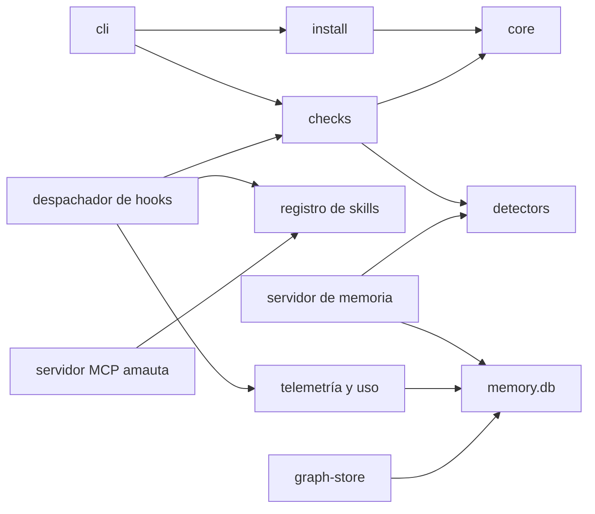
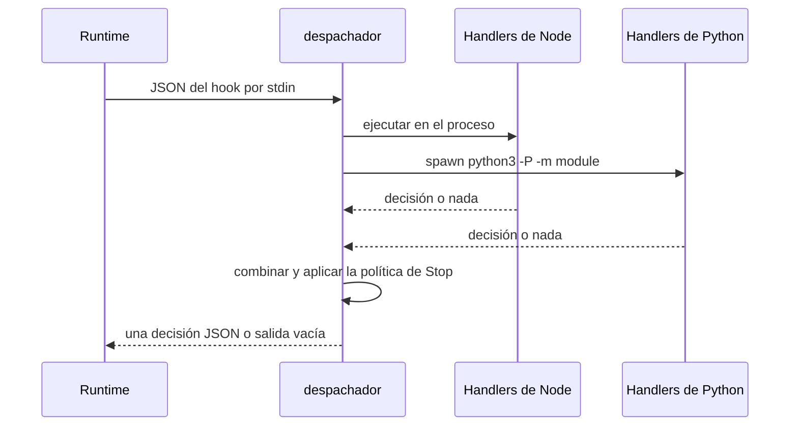

# El núcleo

El núcleo es la parte de amauta que siempre se instala y sobre la que se construyen todas las demás partes. Tiene que mantenerse pequeño: los pilares, los módulos opcionales y los extras pueden importarlo, pero el núcleo solo se importa a sí mismo (ADR 0001). Tres módulos de entrada se sitúan delante de él y le enrutan las peticiones.

## De qué está hecho

Los módulos vienen de `MODULES.json`.

| Módulo | Capa | Rutas | Qué hace |
| --- | --- | --- | --- |
| `cli` | entrada | `bin/`, `src/cli.js` | El enrutador de comandos: cada comando es una entrada de un mapa con un resumen y una función `run` |
| `hooks` | entrada | `src/hooks/` | Puntos de entrada de los hooks para Claude Code y Codex: el despachador por evento y las comprobaciones de edición y de Stop |
| `mcp-server` | entrada | `src/mcp/` | El servidor MCP `amauta`: registro de skills, review assess, estado del modo de revisión, estado de ODD |
| `core` | núcleo | `src/core/`, `src/util/`, `src/version.js`, `python/amauta/__init__.py`, `paths.py`, `oscompat.py`, `extensions.py` | Inyector de marcadores, fusión de JSON y TOML, escrituras atómicas, respaldos, utilidades de git, rutas, la capa de plataforma y el registro de extensiones |
| `install` | núcleo | `src/install/`, `assets/manifest.json`, `assets/core/`, `assets/generic/` | Instalación, desinstalación, estado y sincronización para ambos runtimes; los bloques de instrucciones siempre activos |
| `skills` | núcleo | `src/registry/`, `assets/skills/` | El registro de skills y las skills compartidas de stack y de flujo de trabajo |
| `memory` | núcleo | `python/amauta/memory/`, `assets/engram/` | La memoria SQLite compatible con engram y su servidor MCP |
| `telemetry` | núcleo | `python/amauta/telemetry/`, `python/amauta/usage/` | Eventos locales e ingesta del uso desde las transcripciones |
| `checks` | núcleo | `src/checks/` | El motor de comprobaciones: un solo formato de hallazgo, la versión confirmada como línea base, checkers de sintaxis seguros (ADR 0006) |
| `detectors` | núcleo | `python/amauta/detectors/` | El catálogo de detectores: validadores de identificadores, patrones de secretos, un solo escaneo de texto (ADR 0007) |
| `graph-store` | núcleo | `python/amauta/graph/` | El espejo del grafo de código en `memory.db`, sus consultas y el bloqueo de refresco |

## Cómo se relacionan las partes

Las reglas de capas, comprobadas por `test/architecture.test.js`:

| Capa | Puede importar |
| --- | --- |
| entrada | entrada, núcleo, pilar, integración, opcional |
| núcleo | núcleo |
| pilar | núcleo |
| integración | núcleo |
| opcional | núcleo |
| extra | núcleo, pilar (nada importa un extra de forma estática) |
| herramientas | cualquier cosa |

Un archivo sin módulo, una importación que cruza capas en contra de esta tabla, o una excepción registrada que ya no hace falta hacen fallar el test. Hoy hay una excepción registrada: `install` lee de `code-graph`, porque `status` informa las versiones de codegraph y graphify y el último error del hook de graphify.

## Flujo de uso y de trabajo

Rara vez llamas al núcleo por su nombre; te lo encuentras a través de otros comandos:

- `amauta install` y `amauta status` son el módulo `install` ([[guide:install|Instalación y runtimes]]).
- Cada hook que ejecutan los runtimes es el despachador `hooks`.
- Las herramientas de memoria que llama el agente (`mem_save`, `mem_search`, `mem_context` y otras) son el módulo `memory`, registrado como el servidor MCP `engram` (o `amauta-memory` cuando ya tienes otro `engram`).
- Las comprobaciones después de una edición son el motor `checks` ([[guide:code-security|Seguridad de código]]).
- La guarda de memoria y las herramientas de privacidad comparten el catálogo `detectors` ([[guide:data-security|Seguridad de datos]]).
- El portal lee todo lo que el núcleo guarda ([[guide:portal|El portal]]).

## Scripts y comandos

| Comando | Módulo |
| --- | --- |
| `node bin/amauta.js hook event <Event> --state-dir DIR --with a,b,c` | hooks: el comando que la instalación escribe para cada evento |
| `amauta skill-registry refresh [--cwd DIR] [--quiet] [--no-gitignore] [--force]` | skills |
| `amauta skill-registry list [--cwd DIR]` | skills |
| `amauta py amauta.<module> ...` | cli: ejecuta uno de los módulos Python de amauta con el intérprete que eligió la instalación |
| `PYTHONPATH=python python3 -m amauta.memory serve` | memory: el servidor MCP |
| `PYTHONPATH=python python3 -m amauta.memory import-engram --from FILE` | memory: importación de solo lectura e idempotente de una base de datos de engram |
| `python3 -P -m amauta.telemetry report [--days N] [--json]` y `prune --days N` | telemetry |
| `python3 -P -m amauta.usage backfill [--runtime claude\|codex\|all]` | usage |
| `python3 -P -m amauta.graph query neighbors <node> --repo DIR` y `query path <a> <b> --repo DIR` | graph-store |

Los comandos de telemetría, uso y grafo necesitan `PYTHONPATH=python` (y `AMAUTA_STATE_DIR` para un directorio de estado distinto de `~/.amauta`) cuando los ejecutas desde un checkout.

El servidor MCP `amauta` (`src/mcp/server.js`) es un servidor JSON-RPC hecho a mano sobre stdio con cuatro herramientas:

| Herramienta | Responde |
| --- | --- |
| `skill_registry_refresh` | Refresca `.atl/skill-registry.md` para un proyecto |
| `review_assess` | El riesgo de revisión de los cambios actuales |
| `review_mode_status` | Si el interruptor de revisión está activado y quién lo decidió |
| `odd_tasks_status` | El progreso de los archivos de tareas de ODD |

## Cómo trabaja

### El despachador de hooks

La instalación escribe un comando por evento de hook. El despachador (`src/hooks/dispatch.js`) lee una vez el JSON del hook desde stdin, ejecuta en orden los handlers indicados en `--with` e imprime como mucho una decisión combinada. Los handlers de Node se ejecutan en el mismo proceso; los handlers de Python (telemetría, uso, privacidad) se inician con `spawn`, sin shell, usando el intérprete elegido en la instalación. Cualquier error significa salida vacía y código de salida 0.

| Evento | Handlers |
| --- | --- |
| `UserPromptSubmit` | `skill-registry`, `privacy`, `telemetry` |
| `SessionStart` | `review-stop`, `graphify-connect`, `sync-check`, `telemetry` |
| `PreToolUse` | `privacy` en lecturas (Claude Code), `sdd-preflight` en despachos de agentes con `--with-sdd` |
| `PostToolUse` | `checks` en ediciones (Claude Code), `telemetry` |
| `Stop` | `review-stop`, `checks`, `telemetry`, `usage` |
| `SubagentStop` | `telemetry`, `usage` |

Los handlers de telemetría y uso solo aparecen mientras la telemetría está activada. En Stop, las decisiones de `review-stop` y `checks` pasan por una sola política de Stop: un bloqueo combinado, como mucho dos bloqueos mientras el runtime sigue adelante por un hook de Stop (`<state dir>/stop-policy/<session>.json`).

### memory.db

Un solo archivo SQLite en `<state dir>/memory.db` guarda todo lo local: memorias con búsqueda de texto completo (FTS5, modo WAL, migraciones con `PRAGMA user_version`), los `events` de telemetría, el uso en `usage_messages` y `tool_calls`, y el grafo de código en `graph_nodes`, `graph_edges` y `graph_sync`. Ambos runtimes escriben en el mismo archivo; una columna `runtime` distingue las filas de Claude Code de las de Codex.

- Cada título, contenido, prompt y resumen que escribe la memoria pasa por la **guarda de memoria**: el texto que parece un secreto se rechaza, y los identificadores personales se reemplazan por `[REDACTED_<KIND>]`.
- La telemetría guarda hora, sesión, evento, nombre de la herramienta, proyecto, tamaño del payload y un indicador de éxito; nunca el texto del prompt ni la entrada o salida de las herramientas.
- El uso guarda el modelo, las marcas de tiempo y los conteos de tokens por mensaje, además de los nombres de skills, subagentes y servidores MCP.
- El espejo del grafo se refresca desde el `graph.json` de graphify bajo un bloqueo por repositorio; el servidor de memoria también lo expone como la herramienta `graph_query`.

### El motor de comprobaciones y los detectores

`src/checks/engine.js` define un solo formato de hallazgo, impreso como `file:line:col: severity: message [checker]`, y la regla de línea base: la última versión confirmada del archivo se comprueba en un directorio temporal, así que solo se informan los errores que añadió una edición. `python/amauta/detectors/` valida identificadores (cédula y RUC con dígitos verificadores, tarjetas por Luhn, IBAN, correo electrónico, teléfonos) y patrones de secretos; un hallazgo lleva un tipo y desplazamientos, nunca el texto encontrado.

### El registro de extensiones

`python/amauta/extensions.py` lista `python/amauta/extras/`, importa cada paquete una vez y responde `call(point, ...)` y `collect(point, ...)` a partir de los `POINTS` que declara cada extra. Un extra que no se puede importar no aporta nada, así que un extra roto o borrado nunca rompe el núcleo. Consulta [[guide:extras|Módulos opcionales y extras]].

Volver a [[guide:overview|amauta de un vistazo]].
