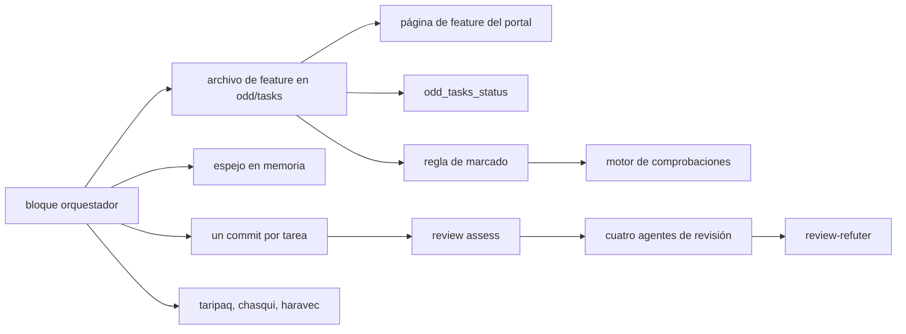
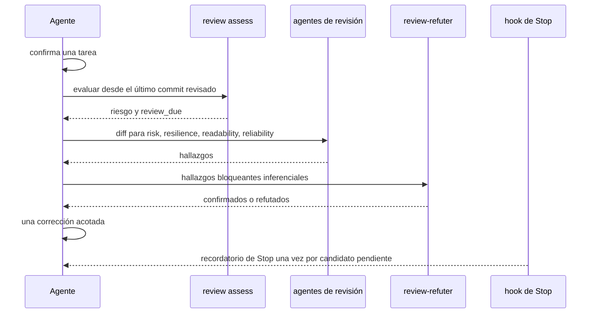

# ODD y revisión

ODD (Organic Driven Development) es la forma de trabajar que el bloque orquestador pone en cada sesión. No es un comando que ejecutes: es un conjunto de instrucciones siempre activas en `CLAUDE.md` y `AGENTS.md` que el agente sigue en cada petición, más unas pocas herramientas que hacen comprobables los pasos: archivos de tareas, el espejo en memoria, la regla de marcado, review assess y las lentes de revisión.

## De qué está hecho

| Parte | Dónde | Papel |
| --- | --- | --- |
| Bloque orquestador | `assets/core/orchestrator.md`, instalado entre marcadores `<!-- amauta:orchestrator -->` | Los pasos de ODD, TDD, delegación, revisión y reglas de seguridad |
| Archivos de tareas | `odd/tasks/<feature>.md` en tu proyecto | Objetivo, alcance, lista de verificación con ids estables, criterios de aceptación, progreso, siguiente paso |
| Espejo en memoria | tema `odd/<feature>/tasks` en `memory.db` | Permite retomar una feature interrumpida |
| Código de revisión | `src/review/` (`assess.js`, `mode.js`, `stop.js`, `pack.js`, `numbers.js`) | Evaluación de riesgo, el interruptor, el recordatorio de Stop, paquetes, fidelidad de cifras |
| Agentes de revisión | `assets/core/agents/review-*.md` | `review-risk`, `review-resilience`, `review-readability`, `review-reliability`, `review-refuter` |
| Lentes y comunicador | `taripaq.md`, `haravec.md`, `chasqui.md` | Lente analítica, lente de comunicación, el redactor de entregables (ADR 0008) |
| Vistas del portal | `#/feature`, la página del proyecto | Progreso, commits, un diagrama de tareas por feature |
| Herramienta MCP | `odd_tasks_status` en el servidor `amauta` | El mismo conteo de ítems que muestra el portal |

## Cómo se relacionan las partes



El archivo de tareas es la fuente de verdad; el espejo en memoria, el portal y la herramienta MCP lo leen. `test/odd-format.test.js` fija el formato y comprueba que el portal y la herramienta MCP cuenten los mismos ítems.

## Flujo de uso y de trabajo

### Los pasos de ODD

1. **Autorizar**: las peticiones de investigación, explicación, revisión y planificación se quedan en solo lectura a menos que pidas implementar. Una petición ambigua recibe una pregunta.
2. **Explorar** el código y los requisitos antes de escribir.
3. **Resolver la incertidumbre**: una pregunta enfocada solo para una decisión de producto real.
4. **Clasificar**: sustancial significa dos o más pasos con sentido, o un progreso que vale la pena recuperar tras una interrupción. El trabajo pequeño sigue siendo pequeño y no recibe archivo de tareas.
5. **Registrar antes de la primera escritura**: crear `odd/tasks/<feature>.md` y reflejarlo con `mem_save` bajo `odd/<feature>/tasks`.
6. **Implementar tarea por tarea**: marcar un ítem solo después de observar su resultado y sus comprobaciones; en una rama de feature, cerrar cada tarea con un Conventional Commit y anotar el hash en el archivo de tareas. Push, PR y merge siguen siendo decisiones tuyas.
7. **Cerrar**: informar el resultado verificado, cada comprobación fallida, omitida o pendiente, y el siguiente paso.

Para retomar, el agente lee `mem_context`, luego `mem_search` para la feature, luego la observación, luego el archivo de tareas, y los concilia.

### TDD

Que TDD esté activado o no lo decide el proyecto o tú, y se anota en el archivo de tareas junto con su runner. Cuando está activado, el test que falla (RED) se observa antes de la implementación, luego GREEN, luego refactor.

### Delegación

El agente principal mantiene un hilo delgado. Leer de uno a tres archivos se hace en línea; necesitar cuatro o más archivos para entender algo significa primero un mapeador de solo lectura. Un archivo mecánico se hace en línea; dos o más archivos no triviales van a un redactor acotado, que recibe los archivos que puede tocar, los criterios de aceptación, el modo TDD y los comandos exactos de verificación. Un redactor a la vez; redactores en paralelo solo en worktrees aislados. La ruta de cada tarea se anota en el archivo de tareas.

### Un archivo de tareas

```markdown
# Feature: weekly sales report
Locator: odd/tasks/weekly-sales.md (branch feat/weekly-sales)

## Objective
## Tasks
- [ ] W1 Extract last week's orders
- [x] W2 Clean the order table (a1b2c3d)
- [!] W3 Publish the report, blocked on access
## Acceptance criteria
## Progress
## Next step
```

Solo cuentan los ítems de primer nivel: `- [ ]` abierto, `- [x]` hecho, `- [!]` bloqueado. Las tareas de datos añaden `## Criteria`, `## Contracts` y `## Review` (ADR 0008).

## Scripts y comandos

| Comando | Qué hace |
| --- | --- |
| `amauta review mode status\|enable\|disable [--scope global\|clone]` | El interruptor de revisión; desactivado por defecto; un `off` local del clon gana sobre el global |
| `amauta review assess --base-ref <commit> --committed-only --json` | Riesgo (`passive`, `medium`, `high`), `review_due` y `review_due_reason` para los cambios desde ese commit |
| `amauta review pack --feature F --kind analytical\|communication` | Escribe `odd/reviews/<F>/<kind>-<n>/pack.md` para una lente nueva |
| `amauta review numbers --feature F` | Cada cifra de un entregable de texto debe existir en los resultados aprobados con la precisión mostrada; si no, sale con 1 |

Carpetas en tu proyecto: `odd/tasks/` (archivos de tareas), `odd/contracts/<feature>/` (resultados aprobados), `odd/deliverables/<feature>/` (lo que escribe `chasqui`), `odd/reviews/<feature>/` (paquetes).

## Cómo trabaja

### El modo de revisión y assess

La revisión es un interruptor que te pertenece. Cuando está activado, después de cada commit de una unidad de trabajo el agente ejecuta `review assess`. Los cambios pasivos (documentación, imágenes) reciben solo una relectura estructural; un fallo de la evaluación cuenta como `high`. Cuando corresponde revisar, los cuatro agentes de revisión reciben el diff, y `review-refuter` comprueba los hallazgos bloqueantes que son inferenciales. Los hallazgos que causó el cambio bloquean; los preexistentes pasan a ser seguimientos. Una corrección acotada por commit, sin bucle hasta que quede limpio.



El hook `review-stop` guarda una línea base en SessionStart y, mientras el interruptor está activado, bloquea un Stop una vez por cada candidato que `review assess` marca como pendiente de revisión. Los resultados de la revisión nunca autorizan un push, un PR ni una publicación.

### Las lentes

Las lentes se ejecutan en su caso incluso cuando la revisión de código está desactivada, a menos que el archivo de tareas diga `Lenses: off`.

- **Análisis cerrado**: `review pack --kind analytical`, luego `taripaq` lee el paquete con un contexto nuevo; sus hallazgos con `needs-refuter: yes` van a `review-refuter`. Una ronda, más una recomprobación del delta tras una corrección.
- **Un entregable para otras personas**: `chasqui` lo escribe solo a partir de los resultados aprobados y puede pedir las medidas que falten (como mucho tres ciclos). Luego `review numbers`, `review pack --kind communication` y un `haravec` nuevo, que lo lee como lo haría la audiencia. Hasta dos rondas, con un `haravec` nuevo en cada una.

Los veredictos se anotan en la sección `## Review` del archivo de tareas.

### La regla de marcado

Una edición de `odd/tasks/*.md` que marca un ítem como hecho, comparada con la versión confirmada, se rechaza mientras los archivos cambiados del repositorio tengan errores que vea el motor de comprobaciones (los mismos hallazgos que la comprobación de Stop). Corrige los errores o deja el ítem abierto. Consulta [[guide:code-security|Seguridad de código]].

Opcional: con `--with-sdd`, el desarrollo guiado por especificaciones está disponible cuando lo pidas ([[guide:extras|Módulos opcionales y extras]]). Volver a [[guide:overview|amauta de un vistazo]].
