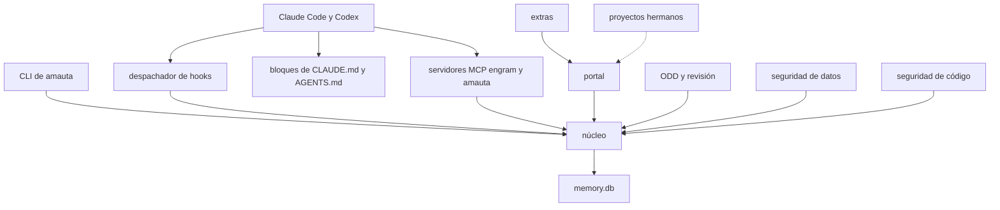
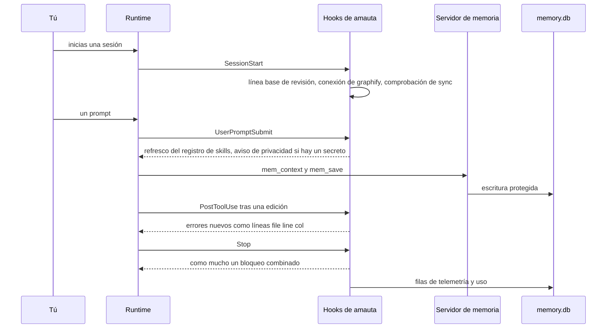

# amauta de un vistazo

amauta es un pequeño arnés para Claude Code y Codex, escrito en Node.js simple (22 o posterior) y Python (3.11 o posterior, solo la biblioteca estándar). Instala instrucciones, hooks, skills, agentes y servidores MCP en ambos runtimes, mantiene una sola memoria local y te da un portal local para ver lo que el arnés sabe. No tiene código compilado propio, ni dependencias de npm, ni código de red en sus hooks o servidores.

Esta página es el mapa. Cada una de las demás páginas de la guía profundiza en una parte.

## De qué está hecho

amauta se organiza en capas (ADR 0001). Cada archivo bajo `bin/`, `src/`, `python/amauta/`, `assets/` y `scripts/` pertenece exactamente a un módulo de `MODULES.json`.

| Capa | Módulos | Más información |
| --- | --- | --- |
| Entrada | `cli`, `hooks` (el despachador), `mcp-server` (el servidor MCP `amauta`) | [[guide:kernel|El núcleo]] |
| Núcleo | `core`, `install`, `skills`, `memory`, `telemetry`, `checks`, `detectors`, `graph-store` | [[guide:kernel|El núcleo]], [[guide:install|Instalación y runtimes]] |
| Pilares | `portal`, `odd`, `data-security`, `code-security` | [[guide:portal|El portal]], [[guide:odd|ODD y revisión]], [[guide:data-security|Seguridad de datos]], [[guide:code-security|Seguridad de código]] |
| Integración | `code-graph` (pegamento hacia `codegraph` y `graphify` encontrados en el `PATH`) | [[guide:kernel|El núcleo]] |
| Opcional | `sdd`, `archify`, `impeccable`, además de las entradas MCP `context7` y `rea` | [[guide:extras|Módulos opcionales y extras]] |
| Extras | `python/amauta/extras/`: pipelines, impacto de skills, explicaciones de la wiki, editor de temas, pasada semántica de graphify, herramientas PBIR | [[guide:pipelines|El orquestador de pipelines]], [[guide:extras|Módulos opcionales y extras]] |
| Herramientas | `scripts/` (migración desde gentle-ai, sondeo de runtimes, comprobaciones de desarrollo) | esta página |

Fuera del repositorio están los **proyectos hermanos**: proyectos que viven junto a amauta, que el portal enlaza y cuya salud comprueba, pero que nunca ejecuta. Consulta [[guide:siblings|Proyectos hermanos]].

Los cuatro pilares responden a cuatro necesidades:

- **Portal**: una wiki local sobre memorias, skills, sesiones, uso, features de ODD y el grafo de código.
- **ODD**: Organic Driven Development, el flujo de trabajo siempre activo para el trabajo sustancial, con archivos de tareas, TDD y revisión.
- **Seguridad de datos**: un catálogo de detectores, la guarda de memoria, el hook de privacidad, herramientas de privacidad y perfiles de organización.
- **Seguridad de código**: comprobaciones al estilo de un compilador después de cada edición y en Stop, contra la última versión confirmada.

## Cómo se relacionan las partes

Claude Code y Codex llegan a amauta por un solo contrato: hooks, servidores MCP sobre stdio, skills y los bloques de instrucciones siempre activos en `CLAUDE.md` y `AGENTS.md`. Detrás de ese contrato, la capa de entrada enruta hacia el núcleo, y los pilares se construyen solo sobre el núcleo.

Las reglas de importación las hace cumplir `test/architecture.test.js`:

- el núcleo solo importa el núcleo;
- los pilares solo importan el núcleo y nunca se importan entre sí;
- los extras pueden importar el núcleo y los pilares, pero nada importa un extra de forma estática: el núcleo los alcanza a través del registro de extensiones (`python/amauta/extensions.py`, ADR 0009);
- las llamadas de Node a Python (`python3 -P -m amauta.<module>`) son fronteras de proceso y, por convención, siguen la misma dirección.

## Flujo de uso y de trabajo

Un día típico con amauta se ve así:

1. **Instala una vez**: `amauta install` escribe los bloques, hooks, skills, agentes y servidores MCP en Claude Code, y en Codex cuando existe `~/.codex`. Consulta [[guide:install|Instalación y runtimes]].
2. **Trabaja en una sesión**: el bloque orquestador hace de ODD el flujo de trabajo por defecto. El trabajo sustancial recibe un archivo de tareas en `odd/tasks/<feature>.md`, reflejado en la memoria. Consulta [[guide:odd|ODD y revisión]].
3. **Deja que los hooks ayuden**: después de una edición, las comprobaciones informan los errores nuevos; en Stop se vuelven a comprobar los archivos cambiados y puede saltar el recordatorio de revisión; el hook de privacidad pregunta antes de leer un archivo de datos.
4. **Míralo**: `amauta portal` (o `amauta portal launch`) muestra memorias, sesiones, uso, features, el grafo, el estado de seguridad, los pipelines y esta guía.
5. **Ejecuta procesos**: el `.amauta/pipelines.json` de un proyecto define trabajos recurrentes que ejecutas desde la terminal o el portal. Consulta [[guide:pipelines|El orquestador de pipelines]].

## Scripts y comandos

Los comandos principales, todos de `amauta --help`:

| Comando | Qué hace |
| --- | --- |
| `amauta install` / `uninstall` / `status` | Instala en Claude Code y Codex, lo quita o informa qué hay |
| `amauta sync` | Sincroniza Claude Code y Codex ahora: servidores MCP en ambos sentidos, enlaces de skills, copias |
| `amauta restore --backup ID` | Deshace una instalación desde su respaldo |
| `amauta upgrade` | Mueve esta instalación a la última etiqueta de versión (`--dry-run`, `--to <tag>`, `--branch <nombre>`) |
| `amauta portal` | Inicia el portal local en 127.0.0.1 |
| `amauta review assess` / `mode` / `pack` / `numbers` | Riesgo de revisión, el interruptor de revisión, paquetes de lentes, fidelidad de cifras |
| `amauta check trust` / `untrust` / `status` | Confía en un proyecto para checkers que ejecutan código y para ejecuciones de pipelines desde el portal |
| `amauta privacy scan` / `redact` / `pseudonymize` | Herramientas locales de privacidad (conteos y columnas, nunca valores) |
| `amauta profile ...` | Perfiles de organización guardados en esta máquina |
| `amauta pipeline ...` | Los pipelines de un proyecto |
| `amauta mermaid check FILE.md...` | Valida bloques Mermaid sin navegador |
| `amauta skill-registry refresh` / `list` | Indexa las skills que un proyecto puede usar |
| `amauta codegraph`, `amauta graphify` | Pegamento hacia las herramientas externas de grafo de código |

Archivos principales: `bin/amauta.js` y `src/cli.js` (enrutador), `MODULES.json` (módulos y capas), `README.md`, `docs/` y `docs/decisions/` (ADR 0001 a 0012).

## Cómo trabaja

Una sesión pasa por amauta en unos pocos puntos fijos. Los hooks se ejecutan mediante un comando despachador por evento, y todo hook falla en abierto: ante cualquier error sale con 0 y salida vacía (el preflight de SDD es la única excepción, solo para los agentes `sdd-*`).

Todo es local. El servidor de memoria, la telemetría y el uso escriben en un solo archivo SQLite, `<state dir>/memory.db` (por defecto `~/.amauta`). El portal lo lee en modo de solo lectura. No se envía nada a ningún lado: el único uso de red es opcional (las entradas MCP `context7` y `rea` se ejecutan mediante `npx`, el motor de impeccable se instala con `npm` una sola vez).

Hacia dónde seguir:

- [[guide:kernel|El núcleo]]: lo que siempre se instala.
- [[guide:install|Instalación y runtimes]]: qué escribe la instalación y cómo la comparten los dos runtimes.
- [[guide:odd|ODD y revisión]]: el método de trabajo.
- [[guide:portal|El portal]]: la wiki local.
- [[guide:data-security|Seguridad de datos]] y [[guide:code-security|Seguridad de código]]: los dos pilares de seguridad.
- [[guide:pipelines|El orquestador de pipelines]]: ejecutar los procesos de un proyecto.
- [[guide:siblings|Proyectos hermanos]]: proyectos junto a amauta.
- [[guide:extras|Módulos opcionales y extras]]: lo que puedes añadir o quitar.
