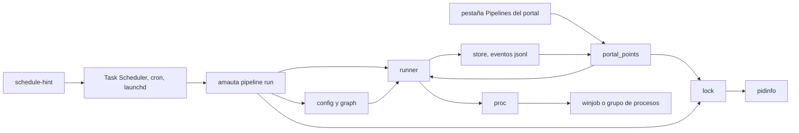
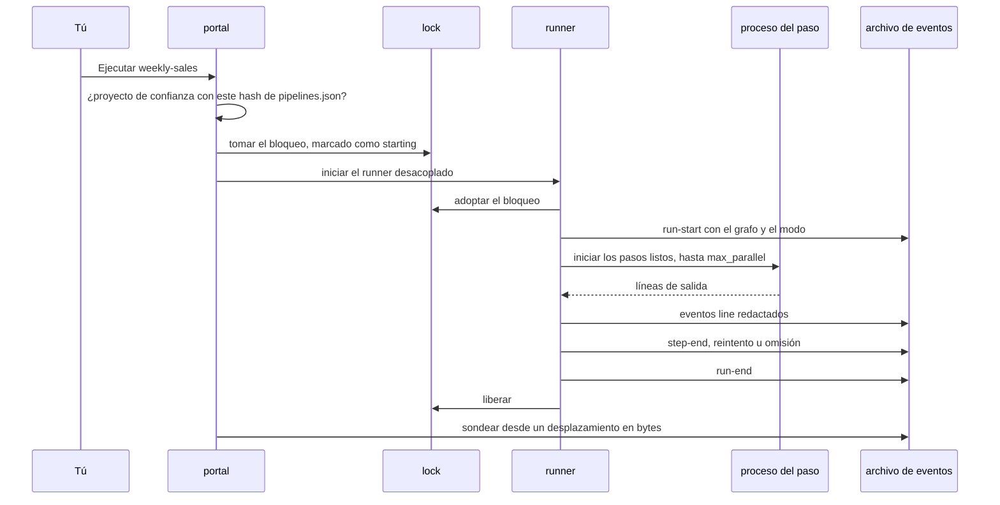

# El orquestador de pipelines

Los pipelines ejecutan los procesos recurrentes de un proyecto (consultas, refrescos de libros de cálculo, scripts, notebooks, informes) y muestran su salida en vivo, desde la terminal o el portal (ADR 0010). Los pasos forman un grafo: los pasos que no dependen entre sí se ejecutan en paralelo, los pasos y los pipelines completos se pueden reutilizar, y los modos activan o desactivan pasos (ADR 0011). Un paso es dueño de sus procesos, y solo hay una ejecución de un pipeline a la vez (ADR 0012). Los pipelines son un extra: borrar `python/amauta/extras/pipelines/` quita la función y nada más.

## De qué está hecho

| Módulo | Papel |
| --- | --- |
| `config.py` | Lee y comprueba `.amauta/pipelines.json`: pasos, bloques, modos, horarios, límites; rechaza una definición con un valor que parece un secreto |
| `graph.py` | Ids de pasos, `needs`, bloques, expansión de sub-pipelines, ciclos y niveles (funciones puras) |
| `runner.py` | Ejecuta un pipeline como un DAG, como mucho `max_parallel` pasos a la vez; reintentos, salidas, redacción, eventos |
| `proc.py` | Un intento de un paso: argv sin shell, entorno, salida leída en un hilo, su árbol de procesos detenido |
| `winjob.py` | Un job object de Windows por paso (kill-on-close), mediante `ctypes` |
| `pidinfo.py` | Si un id de proceso está vivo y cuándo arrancó, para que un pid reutilizado no retenga un bloqueo |
| `lock.py` | Una ejecución a la vez: `<pipeline>.lock`, tomado de forma atómica, adoptado por el runner, caducado cuando su proceso ya no existe |
| `store.py` | Dónde viven las ejecuciones, resúmenes de ejecución, se conservan las 50 ejecuciones más recientes por pipeline |
| `check.py` | `pipeline check`: qué detendría una ejecución, sin ejecutar nada |
| `schedule.py` | Entradas `schedule-hint` para el programador del sistema operativo, y si se perdió una ejecución programada |
| `portal_points.py` | El lado del portal, alcanzado a través del registro de extensiones |
| `__main__.py` | La CLI detrás de `amauta pipeline` |

## Cómo se relacionan las partes



## Flujo de uso y de trabajo

Define los pipelines en el `.amauta/pipelines.json` del proyecto. Un ejemplo sintético:

```json
{
  "blocks": { "clean": { "type": "python", "script": "etl/clean.py", "retries": 1 } },
  "pipelines": [
    { "id": "weekly-sales", "name": "Weekly sales report", "category": "Sales",
      "max_parallel": 2, "modes": ["full", "quick"], "default_mode": "full",
      "schedule": [ { "at": "07:30", "days": ["mon"], "mode": "full" } ],
      "steps": [
        { "id": "orders", "use": "clean", "args": ["orders"] },
        { "id": "stores", "use": "clean", "args": ["stores"], "needs": [] },
        { "id": "model", "type": "r", "script": "analysis/model.R", "needs": ["orders", "stores"], "modes": ["full"] },
        { "id": "book", "type": "command", "argv": ["python", "tools/refresh_book.py"], "needs": ["model"],
          "outputs": ["out/sales.xlsx"], "timeout": 900 } ] } ] }
```

| Tipo de paso | Ejecuta |
| --- | --- |
| `command` | `argv` exactamente como está listado: una lista, nunca una cadena de shell |
| `python` | `python3` (o `interpreter`) con `script` y `args` |
| `r` | `Rscript` (o `interpreter`) con `script` y `args` |
| `notebook` | `jupyter nbconvert --to notebook --execute`, escribiendo `<name>.run.ipynb` junto al original |
| `pipeline` | Se reemplaza al cargar por los pasos de otro pipeline, con nombre `<step id>.<inner id>` |

Por paso, de forma opcional: `id`, `needs`, `timeout` (segundos, por defecto 3600), `cwd`, `enabled: false`, `retries` (0 a 5), `retry_delay` (segundos, por defecto 30), `outputs` (archivos que el paso debe escribir o cambiar), `modes`, `use` (un bloque). Los scripts, notebooks y salidas son relativos a la raíz del proyecto y no pueden llevar fuera de ella, enlaces simbólicos incluidos.

- Un paso sin `needs` espera al paso anterior, así que una lista simple sigue siendo una línea; `needs: []` lo arranca de inmediato.
- Un fallo omite solo los pasos que necesitan el que falló (motivo `needs`); las otras ramas terminan y la ejecución acaba como fallida.
- Un paso fuera del modo de la ejecución se omite y cuenta como hecho.
- Los pasos de bases de datos, libros de cálculo y correo son tus propios scripts: amauta no tiene drivers.

Luego, en el portal, abre **Proyectos > Pipelines**. Cada tarjeta muestra los pasos por niveles con su última duración y marca, el horario y su estado, la última ejecución y los archivos que escribió, las ejecuciones recientes (haz clic en una para reproducirla), **Ejecutar** (pregunta primero), **Comprobar**, **Solo este** por paso y un selector de modo. Primero hay que confiar en el proyecto con `amauta check trust`, porque una ejecución ejecuta su código.

## Scripts y comandos

| Comando | Qué hace |
| --- | --- |
| `amauta pipeline list [--cwd DIR]` | Los pipelines del proyecto |
| `amauta pipeline check [<id>]` | Qué detendría una ejecución (script que falta, programa no encontrado, `cwd` incorrecto); sale con 1 ante un error |
| `amauta pipeline run <id> [--mode M] [--step N] [--python EXE]` | Lo ejecuta, imprimiendo `[step] line`; sale con 0 si va bien, 1 si falla, 130 si se cancela, 3 si ya está en marcha |
| `amauta pipeline status [--json]` | La última ejecución de cada pipeline |
| `amauta pipeline cancel <id>` | Detiene el árbol de procesos completo del paso en marcha |
| `amauta pipeline schedule-hint <id> [--at HH:MM] [--day mon] [--os windows\|linux\|darwin]` | Imprime la entrada para el programador del sistema operativo; amauta no registra nada |
| `amauta check trust` | Confía en el proyecto, con el hash de su `pipelines.json` |

Todos los comandos aceptan también `--cwd DIR` y `--state-dir DIR`. Archivos de ejecución: `<state dir>/pipelines/runs/<project key>/<id>-<time>-<pid>.jsonl`, junto a `<id>.lock`, y archivos `.cancel` y `.log` con el mismo nombre.

## Cómo trabaja



**Eventos.** Una ejecución escribe líneas JSON: `run-start` (con los ids de los pasos, sus `needs` y el modo), `step-start`, `line`, `step-retry`, `step-end` y `run-end`, además de quién la inició (`cli`, `portal` o `schedule`) y cuánto tardó cada paso. Cada línea se redacta mediante el catálogo de detectores, además de un bloque de clave privada desde su línea BEGIN hasta su línea END. Un secreto impreso por partes todavía puede pasar, y el `.run.ipynb` de un notebook conserva sus salidas sin redactar dentro del proyecto.

**Propiedad de los procesos.** Cada paso se ejecuta en su propio grupo de procesos en Linux y macOS, o en un job object en Windows. Ante un tiempo agotado o una cancelación se detienen todos, y lo que el paso dejó en marcha se detiene cuando termina. A un proceso que salió del grupo a propósito y mantiene abierta la salida se le abandona dos segundos después, con una línea que dice que quedó en marcha.

**Una ejecución a la vez.** Quien inicia una ejecución toma `<id>.lock` de forma atómica: el portal, la terminal o una ejecución programada. El bloqueo registra su id de proceso y su hora de inicio, así que un proceso muerto o zombi, o un proceso distinto que recibió el mismo pid, ya no lo retiene. Una ejecución cuyo runner se detuvo sin cerrarla se lee como abandonada. SIGTERM o Ctrl+C cancelan la ejecución y aun así escriben su final.

**Entorno.** Los pasos heredan el entorno de quien inició la ejecución, con tu propio `PYTHONPATH` (sin la carpeta de amauta), más `AMAUTA_PIPELINE`, `AMAUTA_PIPELINE_TRIGGER`, `AMAUTA_PIPELINE_STEP` y `AMAUTA_PIPELINE_MODE`. Un script puede, por ejemplo, enviar su correo solo cuando el disparador es `schedule`.

**Confianza por hash.** El navegador solo envía un proyecto, un id de pipeline y un número de paso o un modo, nunca un comando. El portal ejecuta un pipeline solo mientras `.amauta/pipelines.json` tenga el hash registrado por `amauta check trust`; después de cualquier cambio, tuyo o de un `git pull`, revísalo y vuelve a confiar. La CLI y el programador del sistema operativo ejecutan lo que pediste y no necesitan confianza.

**Horarios.** `schedule` es un objeto o una lista: `{"at": "07:30"}`, con `days`, con `day_of_month` (1 a 28), o `{"every_minutes": 30}`, cada uno opcionalmente con un `mode`. `schedule-hint` imprime una línea `schtasks /Create` en Windows, una línea de crontab en Linux y un agente de launchd en macOS, cada uno ejecutando `amauta pipeline run <id> --trigger schedule --cwd <project>` con el `PATH` de esta terminal. El portal compara las ejecuciones programadas con el horario declarado y avisa cuando todavía no ha ocurrido ninguna o se perdió una, con 30 minutos de margen.

**Límites.** Los pasos se ejecutan con tus permisos y tu entorno, claves incluidas: amauta no los aísla. `max_parallel` va de 1 a 16 (por defecto 4); un tiempo límite es como mucho de 24 horas. Si el propio runner se mata de golpe, el paso en marcha sigue por su cuenta y la ejecución se lee como abandonada.

Relacionado: [[guide:portal|El portal]], [[guide:code-security|Seguridad de código]] para la confianza, [[guide:extras|Módulos opcionales y extras]] para cómo se conectan los extras.
