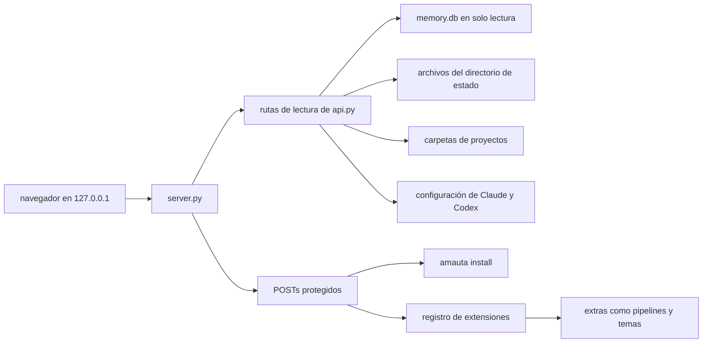
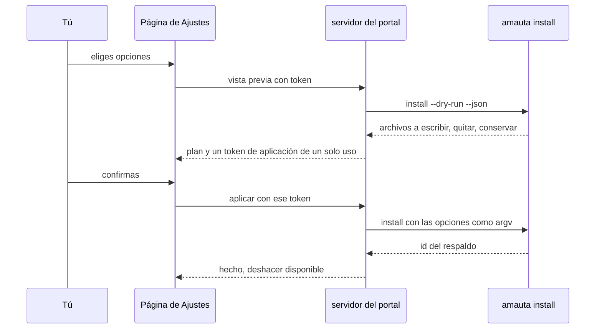

# El portal

El portal es una wiki local sobre todo lo que el arnés sabe: memorias, skills, herramientas, servidores MCP, sesiones, uso, features de ODD, el grafo de código, pipelines, el estado de seguridad y esta guía. Cada elemento es una página enlazada con retroenlaces. Es un servidor Python de la biblioteca estándar más una interfaz de una sola página en JavaScript simple, sin CDN y sin red; se enlaza solo a `127.0.0.1` y se ejecuta bajo demanda, nunca como servicio en segundo plano (ADR 0005).

## De qué está hecho

| Parte | Dónde | Papel |
| --- | --- | --- |
| Lanzador y CLI | `src/portal/` (`cli.js`, `launch.js`, `launcher.js`, `windows.js`) | `amauta portal`, `portal launch`, `portal install-launcher` |
| Servidor | `python/amauta/portal/server.py` | HTTP en loopback, cabeceras estrictas, comprobaciones de token y de origen en las escrituras |
| API | `python/amauta/portal/api.py` | Las rutas `GET /api/...` de solo lectura |
| Wiki | `wiki*.py` | Páginas, búsqueda, retroenlaces, lint, la wiki del arnés, la página de inicio |
| Proyectos, hermanos | `projects.py`, `siblings.py`, `config.py` | Proyectos conocidos desde `portal.json`, `--repo` y las raíces git de las sesiones; salud de los hermanos |
| Ajustes | `settings.py` | El editor de ajustes protegido, que ejecuta el instalador |
| Seguridad | `security.py` | La página de Seguridad: protecciones, checkers, proyectos de confianza, perfiles |
| Diagramas | `diagrams.py`, `archify.py`, `static/mermaid.min.js` | Código Mermaid generado en el servidor; la versión vendorizada de Mermaid; archify cuando está instalado |
| Guía | `guide.py`, `guide/en/`, `guide/es/` | Estas páginas |
| Interfaz | `static/` | `app.js`, un `page-*.js` por página, `markdown.js` (el subconjunto seguro de Markdown), `i18n/en.json` y `es.json`, `style.css` |

## Cómo se relacionan las partes



La barra lateral tiene siete páginas; sus otras rutas aparecen como pestañas:

| Página | Pestañas y rutas |
| --- | --- |
| Inicio | `#/` actividad reciente por día; un panel lateral con gasto, impacto de skills y salud del arnés |
| Proyectos | `#/project`, features de ODD `#/feature`, Grafo `#/node`, Pipelines `#/pipelines`; tarjetas de hermanos |
| Memoria | `#/memory`, Lint `#/lint` |
| Actividad | Uso `#/usage`, Sesiones `#/session`, Herramientas `#/tool`, Servidores MCP `#/mcp` |
| Arnés | `#/harness`, Skills `#/skill`, Componentes `#/component`, Guía `#/guide` |
| Seguridad | `#/security` |
| Ajustes | `#/settings`, Temas `#/themes` |

## Flujo de uso y de trabajo

```bash
amauta portal                       # sirve en 127.0.0.1, puerto 8765 por defecto
amauta portal launch                # una ventana de aplicación; el servidor se detiene al cerrarla
amauta portal install-launcher      # una entrada de escritorio o un acceso directo en el menú Inicio
```

- Busca con `Ctrl+K` o `/`: una sola consulta sobre memorias (texto completo), skills, herramientas, servidores MCP, sesiones, features, tareas y nodos del grafo.
- Usa los filtros de Rango, Proyecto y Runtime sobre las páginas que los tienen (Todos, Claude Code, Codex).
- Cambia el tema (Sistema, Claro, Oscuro, tus propios temas) y el idioma (inglés, español) al pie de la barra lateral. Tu propio texto se queda como lo escribiste; las fechas son siempre `YYYY-MM-DD`.
- Añade proyectos en Ajustes > Proyectos, o con `--repo DIR` (repetible).
- Lee esta guía en Arnés > Guía; cada página sigue el idioma del portal y recurre al inglés si falta.

## Scripts y comandos

| Comando | Qué hace |
| --- | --- |
| `amauta portal [--port N] [--repo DIR]... [--claude-home DIR] [--engram-db FILE] [--state-dir DIR] [--idle-exit S]` | Inicia el servidor |
| `amauta portal launch [--idle-exit S]` | Puerto libre, servidor desacoplado, ventana `--app` de Chrome o Edge con su propio perfil |
| `amauta portal install-launcher [--remove]` | `~/.local/share/applications/amauta-portal.desktop` en Linux, `amauta.lnk` en el menú Inicio en Windows |
| `PYTHONPATH=python python3 -P -m amauta.portal ...` | El mismo servidor sin el envoltorio de la CLI |

Archivos del directorio de estado que lee el portal: `portal.json` (`repos`, `auto_discover`, `siblings`), `themes/*.json`, `prices.json` (sin él, las estimaciones de costo quedan desactivadas), `wiki/` (descripciones de herramientas en caché, peticiones de explicación y notas), `portal/run.json` y `portal/portal.log` para un servidor lanzado.

## Cómo trabaja

### Lectura

Cada base de datos se abre con `mode=ro`: nunca se crea ni se migra. Los proyectos vienen de `--repo`, de `portal.json` y de las raíces git de tus sesiones; el descubrimiento automático solo busca dentro de tu directorio home y omite los worktrees de git enlazados. Los datos del arnés (hooks, servidores MCP, agentes, comandos, plugins, estilos de salida) se reconstruyen desde los archivos reales en cada petición y se guardan en caché un par de segundos; cada página de componente nombra la fuente de cada dato. Las configuraciones MCP muestran la forma del comando y de los argumentos con los secretos enmascarados, y solo los nombres de las variables de entorno.

Los enlaces de las memorias se derivan, ya que el almacén no tiene tabla de relaciones: `[[wikilinks]]`, la jerarquía de `topic_key`, menciones de palabras completas y etiquetas del grafo. Todo el texto de memorias, repositorios y grafos pasa por el subconjunto seguro de Markdown como nodos de texto, bajo una Content-Security-Policy estricta; no hay HTML crudo.

### Escritura

Las escrituras pasan solo por endpoints POST protegidos: solo JSON, con tamaño limitado, un token por proceso, comprobaciones de `Host` y `Origin` y esquemas cerrados. Cubren Refrescar uso, el heartbeat, el editor de ajustes, la configuración de proyectos y hermanos, la sincronización y conexión del grafo, el refresco de descripciones de herramientas, las peticiones de explicación, los temas, y la ejecución y cancelación de pipelines.



El editor de ajustes cambia una lista cerrada: persona, modo de revisión, telemetría, los módulos opcionales y reinstalar o reparar. El portal nunca edita por sí mismo un archivo del arnés. El token de aplicación es válido cinco minutos y está ligado a las opciones elegidas y al hash de `state.json`. **Deshacer** vuelve a ejecutar la instalación con los ajustes anteriores al cambio más reciente hecho desde el portal; nunca restaura instantáneas de archivos.

### Diagramas

El portal incluye una versión sin modificar de Mermaid, que se carga solo cuando se dibuja el primer diagrama, con `securityLevel: 'strict'`. El código Mermaid del progreso de tareas, de los vecindarios del grafo y de la arquitectura del arnés se genera en el servidor con ids generados y etiquetas escapadas y acotadas. Las memorias y las páginas de la guía dibujan sus propios bloques Mermaid. Con archify instalado, la página del Arnés dibuja la arquitectura con él dentro de un marco aislado.

### Extras en el portal

Algunas pestañas vienen de extras a través del registro de extensiones: la pestaña Pipelines ([[guide:pipelines|El orquestador de pipelines]]), el editor de temas, el impacto de skills y las explicaciones de la wiki ([[guide:extras|Módulos opcionales y extras]]). Borrar la carpeta de un extra quita su pestaña o bloque y nada más.

### Lanzador

`portal launch` inicia el servidor desacoplado y abre una ventana del navegador. La página envía un heartbeat cada 10 segundos; un servidor lanzado termina cuando dejan de llegar heartbeats (`--idle-exit`, 30 segundos por defecto). Un segundo lanzamiento reutiliza el servidor en marcha.

Consulta también [[guide:siblings|Proyectos hermanos]] para las tarjetas de hermanos y [[guide:data-security|Seguridad de datos]] para lo que informa la página de Seguridad.
