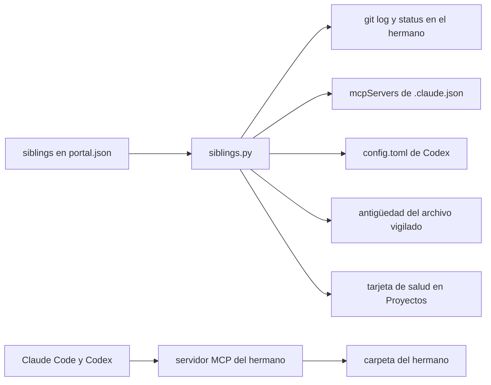
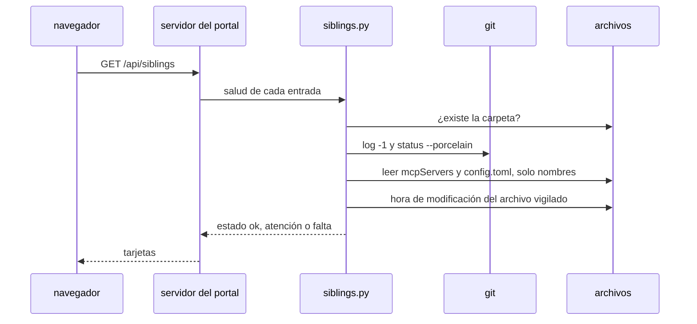

# Proyectos hermanos

Un proyecto hermano es un proyecto que vive junto a amauta, en su propio repositorio, con sus propias dependencias y su propio ritmo de publicación. amauta no lo importa, no lo instala ni lo ejecuta: el portal solo lo enlaza y comprueba su salud (ADR 0001). Hermanos típicos son un catálogo de datos o un repositorio de ETL que usas junto con Claude Code o Codex.

## De qué está hecho

| Parte | Dónde | Papel |
| --- | --- | --- |
| Entradas de hermanos | `<state dir>/portal.json`, clave `siblings` | Una lista cerrada de como mucho 20 entradas |
| Validación y salud | `python/amauta/portal/siblings.py` | Comprueba cada entrada; lee git, los registros MCP y un archivo vigilado |
| Formulario de ajustes | Ajustes > Proyectos hermanos en el portal | Edita la lista mediante un POST protegido |
| Tarjetas de salud | la página de Proyectos, `GET /api/siblings` | Una tarjeta por hermano con una marca |
| El propio hermano | en cualquier lugar de tu disco | Su propio código, tests, dependencias y, a menudo, su propio servidor MCP |

Una entrada tiene estas claves, y ninguna otra:

| Clave | Obligatoria | Significado |
| --- | --- | --- |
| `name` | sí | De 1 a 60 caracteres, se muestra en la tarjeta |
| `path` | sí | La carpeta del hermano; las mismas reglas de ruta que los proyectos configurados (no `/`, no tu propio home, no carpetas del sistema) |
| `mcp` | no | El nombre del servidor MCP del hermano, tal como está registrado en Claude Code y Codex |
| `watch` | no | Una ruta relativa dentro del hermano cuya antigüedad indica qué tan reciente es (una exportación, un corte del catálogo) |
| `max_age_days` | no | De 1 a 366; el archivo vigilado queda desactualizado tras esa cantidad de días |

## Cómo se relacionan las partes



Los runtimes hablan directamente con el hermano, a través de su propio servidor MCP, que registras como cualquier otro. amauta se queda a un lado: sincroniza esa entrada MCP entre Claude Code y Codex como cualquier otro servidor stdio ([[guide:install|Instalación y runtimes]]) y muestra si ambos runtimes la tienen.

## Flujo de uso y de trabajo

1. Mantén el hermano en su propia carpeta y repositorio, con su propia configuración.
2. Registra su servidor MCP en Claude Code o Codex si tiene uno; `amauta sync` copia una entrada stdio al otro runtime.
3. Añádelo en Ajustes > Proyectos hermanos, o edita `portal.json`:

```json
{
  "siblings": [
    { "name": "Data catalog", "path": "/home/you/code/data-catalog", "mcp": "catalog",
      "watch": "catalog/CURRENT", "max_age_days": 35 }
  ]
}
```

4. Abre la página de Proyectos. Cada tarjeta muestra el último commit y el número de cambios sin confirmar, si el servidor MCP nombrado en `mcp` está registrado para Claude (`.claude.json`) y para Codex (`config.toml`), y la antigüedad del archivo vigilado.

La marca dice qué necesita atención:

| Marca | Significado |
| --- | --- |
| ✓ | Todo bien |
| ▲ | Atención: cambios sin confirmar, el servidor MCP no está registrado en ningún runtime, o el archivo vigilado falta o está desactualizado |
| ✗ | Falta la carpeta |

### Un ejemplo: un catálogo de datos como oga_catalog

Un catálogo de datos es un buen hermano. Imagina un proyecto como oga_catalog: un catálogo local de conjuntos de datos, tablas y definiciones de métricas que las personas aprueban a mano antes de que un corte nuevo pase a ser el actual, más un pequeño servidor MCP de solo lectura para que un agente pueda consultar sin tocar las fuentes. Necesita sus propias bibliotecas y sus propios pasos de publicación, así que se queda fuera de amauta. La entrada del hermano apunta a su carpeta, nombra su servidor MCP y vigila el archivo que marca el corte aprobado actual, así que la tarjeta pasa a atención cuando el catálogo no se ha refrescado a tiempo. Todo lo demás, incluido cómo se construye y se aprueba el catálogo, es asunto del propio hermano.

## Scripts y comandos

amauta no tiene un comando propio para los hermanos; usas el portal y los comandos que ya tienes.

| Comando o archivo | Uso |
| --- | --- |
| `amauta portal`, página de Proyectos | Las tarjetas de salud |
| Ajustes > Proyectos hermanos | Editar la lista |
| `<state dir>/portal.json` | La misma lista como archivo: `{"repos": [...], "auto_discover": true, "siblings": [...]}` |
| `GET /api/siblings` | Los datos de salud como JSON (solo lectura) |
| `amauta sync` | Copia la entrada MCP stdio del hermano entre Claude Code y Codex |
| `amauta status` | Lista los servidores MCP presentes en un runtime y no en el otro |

## Cómo trabaja



El portal solo lee la carpeta del hermano y esos dos archivos de configuración. Ejecuta `git` en el hermano con un tiempo límite de 10 segundos, lee la hora de un archivo y busca el nombre del servidor MCP en las dos configuraciones sin leer el comando ni el entorno del servidor. Las entradas se validan con un esquema cerrado: se rechazan las claves desconocidas, un `watch` absoluto o relativo a la carpeta padre, o un nombre MCP con caracteres raros; una entrada incorrecta en el archivo se descarta.

### Por qué amauta nunca ejecuta código de un hermano

- **Dependencias.** Los hermanos necesitan bibliotecas que amauta no debe cargar: amauta se mantiene en Node.js simple y Python de la biblioteca estándar, sin dependencias de npm (el ADR 0001 rechazó integrar los hermanos como módulos por esta razón).
- **Confianza.** Ejecutar el código de otro proyecto desde el portal ejecutaría código que no pediste; amauta reserva eso solo para los pipelines, detrás de `amauta check trust` y de un hash de la definición ([[guide:pipelines|El orquestador de pipelines]]).
- **Propiedad.** El hermano decide cómo se construye, se prueba y se publica; amauta solo te dice si parece sano.

Si quieres que amauta ejecute un trabajo de un hermano según un horario, define un pipeline en un proyecto de confianza cuyo paso `command` llame al script propio del hermano. Volver a [[guide:overview|amauta de un vistazo]].
